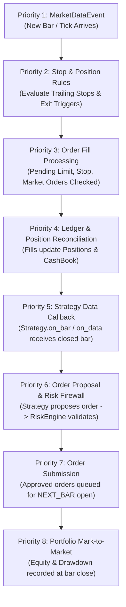
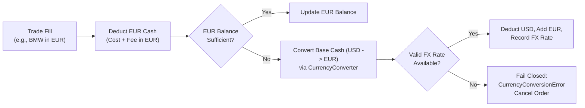
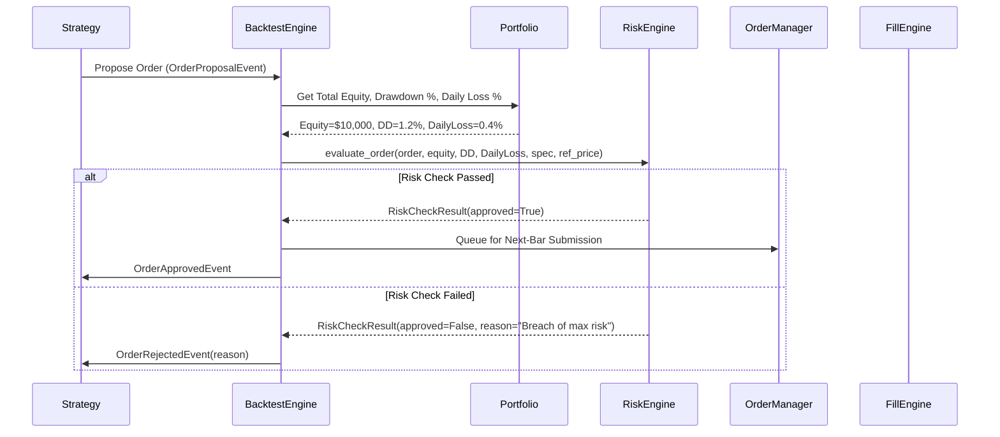
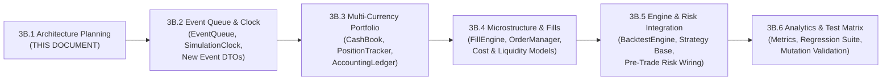

# Native Event-Driven Backtesting Engine: Architecture & Implementation Specification (Milestone 3B)

## Executive Summary

Following the empirical evaluation of Milestone 3A (documented in `docs/BACKTEST_EVALUATION.md`), we formally selected **Option B**: designing and building our own **native event-driven backtesting engine** within `hybrid-ai-trading-agent`.

This document establishes the comprehensive technical architecture, event lifecycle, execution semantics, multi-currency accounting models, risk engine integration, mathematical invariants, and test matrix for Milestone 3B.

### Core Architectural Directives
1. **Zero External Framework Coupling**: Built natively inside `src/hybrid_agent/execution/backtest/` without external backtesting dependencies.
2. **Domain Model Primacy**: Directly utilizes established domain models (`Bar`, `Tick`, `Order`, `InstrumentSpecification`, `DataProvenance`, `RiskEngine`).
3. **Chronological Next-Bar Causality**: Enforces mandatory next-bar open execution for bar-based strategies. Same-bar close execution is strictly prohibited.
4. **Conservative Microstructure Fills**: Fills adverse gaps at bar Open. Enforces conservative stop-first execution on volatile bars touching both stop-loss and take-profit levels.
5. **Multi-Currency CashBook**: Multi-currency ledger with fail-closed currency conversion via `CurrencyConverter`. Mismatched currencies are never blended nominally 1:1.
6. **Pre-Trade Risk Firewall Integration**: Integrates the existing `RiskEngine` with dynamic equity, drawdown, daily loss, and monetary risk calculations.
7. **Deterministic Replay**: Guarantees identical execution replay through a strictly ordered event queue `(timestamp, priority, sequence_id)`.

---

## 1. Existing Source Code & Reusability Audit

An audit of the existing codebase confirms the reusable assets and required extensions:

| Module | Existing Components | Reusability Assessment & Required Extensions |
| :--- | :--- | :--- |
| `core/models.py` | `Bar`, `Tick`, `Quote`, `InstrumentSpecification`, `Order`, `Position`, `DataProvenance` | **100% Reusable**. `InstrumentSpecification` provides contract sizing, tick size, and currency metadata. `Order` provides lifecycle transitions. Position provides notional and monetary risk properties. |
| `core/constants.py` | `OrderSide`, `OrderType`, `OrderStatus`, `ValuationModel`, `ALLOWED_ORDER_TRANSITIONS` | **Reusable with Extension**. Add `OrderStatus.PARTIALLY_FILLED` and update `ALLOWED_ORDER_TRANSITIONS` to support institutional partial fill lifecycles: `SUBMITTED -> PARTIALLY_FILLED -> FILLED/CANCELLED`. |
| `core/events.py` | `BaseEvent`, `MarketTickEvent`, `MarketBarEvent`, `SignalEvent`, `OrderProposalEvent`, `OrderApprovedEvent`, `OrderRejectedEvent` | **Reusable Base**. Add execution events: `OrderSubmittedEvent`, `OrderPartiallyFilledEvent`, `OrderFilledEvent`, `OrderCancelledEvent`, `PositionUpdatedEvent`, `PortfolioMarkedEvent`, `BacktestCompletedEvent`. |
| `execution/base.py` | `BaseBroker` | **Abstract Base**. Serves as the base interface that `BacktestBroker` implements to expose broker methods to strategies. |
| `risk/policy.py` | `RiskEngine`, `CurrencyConverter`, `SimpleFixedRateConverter`, `resolve_executable_price` | **100% Reusable**. Pre-trade firewall executes without modification, provided the backtester supplies accurate portfolio equity, drawdown, and daily loss metrics. |
| `config/settings.py` | `AppSettings`, `ExecutionMode` | **100% Reusable**. Provides risk limits (`max_daily_loss_pct`, `max_drawdown_limit_pct`, `max_risk_per_trade_pct`, `max_position_size_pct`). |
| `data/storage.py` | `ParquetStorageEngine`, `DuckDBAnalyticalEngine` | **Data Source**. Supplies historical `Bar` sequences partitioned by symbol and timeframe with validated half-open intervals `[start, end)`. |
| `features/pipeline.py` | `FeaturePipeline`, `StatefulIncrementalFeatureEngine` | **Feature Source**. Emits technical indicators causally with zero lookahead bias. |

---

## 2. Package Architecture: `src/hybrid_agent/execution/backtest/`

The engine is organized into focused, single-responsibility modules:

```
src/hybrid_agent/execution/backtest/
├── __init__.py               # Public API exports
├── engine.py                 # BacktestEngine coordinator & main simulation loop
├── event_queue.py            # Deterministic priority EventQueue (timestamp, priority, seq)
├── clock.py                  # SimulationClock strictly monotonic time manager
├── config.py                 # BacktestConfig immutable configuration data structure
├── portfolio.py              # Portfolio combining CashBook & PositionTracker
├── cashbook.py               # Multi-currency CashBook with fail-closed FX conversion
├── positions.py              # PositionTracker (FIFO / average-cost inventory accounting)
├── order_manager.py          # Pending order queues, bracket tracking, OCO linking
├── fill_engine.py            # Microstructure order matcher & fill evaluator
├── execution_models.py       # FillModel protocol & DefaultFillModel
├── spread.py                 # SpreadModel (Quote spread & synthetic fallback)
├── slippage.py               # SlippageModel (Fixed, Spread, VolumeShare impact)
├── commission.py             # CommissionModel (PerTrade, PerShare, Percentage)
├── liquidity.py              # LiquidityModel (Volume participation caps)
├── accounting.py             # AccountingLedger (immutable double-entry transaction record)
└── metrics.py                # PerformanceAnalyticsEngine (Sharpe, Drawdown, Expectancy)
```

### Module Responsibility Matrix

| Module | Primary Responsibility | Collaborators / Dependencies |
| :--- | :--- | :--- |
| `engine.py` | Coordinates timeline iteration, event dispatching, and run lifecycle. | `EventQueue`, `SimulationClock`, `Portfolio`, `OrderManager`, `FillEngine`, `RiskEngine` |
| `event_queue.py` | Deterministic priority queue ordered by `(timestamp, priority, sequence_id)`. | `BaseEvent` hierarchy |
| `clock.py` | Maintains strictly monotonic simulation clock ($t_{next} \ge t_{current}$). | `datetime` (UTC) |
| `config.py` | Defines execution parameters, initial cash, cost models, and policies. | `hybrid_agent.config.settings` |
| `cashbook.py` | Multi-currency cash ledger; executes fail-closed conversions. | `CurrencyConverter`, `SimpleFixedRateConverter` |
| `positions.py` | Tracks active positions, average entry prices, and realized/unrealized P&L. | `Position`, `InstrumentSpecification` |
| `portfolio.py` | Computes total equity, drawdown, daily loss, and notional exposure. | `CashBook`, `PositionTracker` |
| `order_manager.py` | Manages pending limit, stop, and bracket orders with OCO cancellation. | `Order`, `OrderStatus` |
| `fill_engine.py` | Evaluates price conditions against bars/ticks and executes fills. | `FillModel`, `SpreadModel`, `SlippageModel`, `CommissionModel`, `LiquidityModel` |
| `execution_models.py`| Defines protocols and default logic for order fill verification. | `Bar`, `Tick`, `Order` |
| `spread.py` | Supplies bid/ask spread from top-of-book quotes or declared spread. | `Tick`, `Quote` |
| `slippage.py` | Calculates price adjustment due to market friction and size impact. | `Bar`, `Order` |
| `commission.py` | Computes broker commission and exchange fees per execution. | `Order` |
| `liquidity.py` | Enforces bar volume participation limits and calculates partial fills. | `Bar`, `Order` |
| `accounting.py` | Immutable transaction journal of all cash flows and fills. | `OrderFilledEvent`, `CashBook` |
| `metrics.py` | Calculates institutional risk-adjusted return and trade metrics. | `Portfolio`, `AccountingLedger` |

---

## 3. Event Architecture & Lifecycle

### 3.1 Event Hierarchy

```
BaseEvent (timestamp: UTC)
├── MarketDataEvent
│   ├── MarketBarEvent (bar: Bar)
│   └── MarketTickEvent (tick: Tick)
├── SignalEvent (symbol, score, confidence, direction)
├── OrderLifecycleEvent
│   ├── OrderProposalEvent (order: Order)
│   ├── OrderApprovedEvent (order: Order)
│   ├── OrderRejectedEvent (order: Order, reason: str)
│   ├── OrderSubmittedEvent (order: Order)
│   ├── OrderPartiallyFilledEvent (order: Order, fill_price, fill_qty, fee, slippage)
│   ├── OrderFilledEvent (order: Order, fill_price, fill_qty, fee, slippage)
│   └── OrderCancelledEvent (order: Order, reason: str)
├── PortfolioStateEvent
│   ├── PositionUpdatedEvent (position: Position)
│   └── PortfolioMarkedEvent (equity, cash, unrealized_pnl, realized_pnl, drawdown_pct)
└── BacktestCompletedEvent (result: BacktestResult)
```

### 3.2 Intra-Timestamp Event Priority & Deterministic Sequencing

When multiple events share an identical timestamp $T$, the `EventQueue` dispatches them in strict deterministic priority order:



#### Deterministic Queue Sorting Tuple
Every event in the queue is prioritized by:
$$\text{SortKey} = (\text{timestamp: datetime}, \text{priority: int}, \text{sequence\_id: int})$$
- `timestamp`: Monotonic UTC datetime.
- `priority`: Integer from 1 (Market Data) to 8 (Mark-to-Market).
- `sequence_id`: Auto-incrementing integer guaranteeing stable FIFO ordering among identical priorities.

#### Prevention of Time Reversal
If an event is enqueued with $T_{\text{event}} < T_{\text{clock}}$, the `EventQueue` raises a `TemporalOrderViolationError`. Time reversal is physically prohibited.

---

## 4. Execution Semantics & Fill Logic

### 4.1 Chronological Next-Bar Execution Contract
- **Causal Invariant**: A trading signal computed on bar $t$ (which closes at $T_{\text{close}}$) can only submit orders eligible for execution on bar $t+1$ (starting at $T_{\text{close}}$).
- **Execution Price**: Market orders submit with `eligible_time = bar[t+1].start_time` and fill at bar $t+1$ Open:
  $$P_{\text{fill}} = \text{Open}_{t+1} \pm \frac{\text{Spread}}{2} \pm \text{Slippage}$$
- Same-bar close execution is strictly forbidden in quantitative research backtests.

### 4.2 Fill Execution Decision Table

| Order Type | Trigger Condition (Bar $t+1$) | Base Execution Price | Microstructure Price Adjustment |
| :--- | :--- | :--- | :--- |
| **Market BUY** | Unconditional at Bar Start | $\text{Open}_{t+1}$ | $P_{\text{fill}} = \text{Open} + \frac{\text{Spread}}{2} + \text{Slippage}$ |
| **Market SELL** | Unconditional at Bar Start | $\text{Open}_{t+1}$ | $P_{\text{fill}} = \text{Open} - \frac{\text{Spread}}{2} - \text{Slippage}$ |
| **Limit BUY** | $\text{Low}_{t+1} \le P_{\text{limit}}$ | $\min(\text{Open}_{t+1}, P_{\text{limit}})$ | $P_{\text{fill}} = \text{BasePrice} + \frac{\text{Spread}}{2}$ (Price improved if Open < Limit) |
| **Limit SELL** | $\text{High}_{t+1} \ge P_{\text{limit}}$ | $\max(\text{Open}_{t+1}, P_{\text{limit}})$ | $P_{\text{fill}} = \text{BasePrice} - \frac{\text{Spread}}{2}$ (Price improved if Open > Limit) |
| **Stop-Loss BUY** (Short Exit) | $\text{High}_{t+1} \ge P_{\text{stop}}$ | $\max(\text{Open}_{t+1}, P_{\text{stop}})$ | $P_{\text{fill}} = \text{BasePrice} + \frac{\text{Spread}}{2} + \text{Slippage}$ (Adverse gap filled at Open) |
| **Stop-Loss SELL** (Long Exit) | $\text{Low}_{t+1} \le P_{\text{stop}}$ | $\min(\text{Open}_{t+1}, P_{\text{stop}})$ | $P_{\text{fill}} = \text{BasePrice} - \frac{\text{Spread}}{2} - \text{Slippage}$ (Adverse gap filled at Open) |
| **Bracket Order** | Entry fills -> Activates TP & SL | Sibling OCO | When TP or SL fills, sibling is immediately cancelled |

### 4.3 Ambiguous Intrabar Execution (Conservative Stop-First Policy)
When a high-volatility bar spans both the stop-loss price and take-profit price ($Low \le SL$ and $High \ge TP$):
```
                      +----------------------------+
                      | Bar Spans Both SL and TP?  |
                      +--------------+-------------+
                                     |
                                     v
                      +----------------------------+
                      | Conservative Policy:       |
                      | Stop-Loss Executes First   |
                      +--------------+-------------+
                                     |
                                     v
                      +----------------------------+
                      | SL Filled at Exit Price    |
                      | TP Order Cancelled (OCO)   |
                      +----------------------------+
```
**Rationale**: In quantitative trading, assuming take-profit was touched before stop-loss introduces severe positive survivor bias. Our engine defaults to worst-case conservative execution.

### 4.4 Liquidity Constraints & Partial Fills
When an order size $Q_{\text{order}}$ exceeds the maximum participation limit of bar volume ($V_{\text{bar}} \times \rho_{\text{max}}$):
1. **Fill Quantity**: $Q_{\text{fill}} = \min(Q_{\text{remaining}}, V_{\text{bar}} \times \rho_{\text{max}})$.
2. **Remainder**: $Q_{\text{remaining}} = Q_{\text{remaining}} - Q_{\text{fill}}$.
3. **Order State**: Transitions to `OrderStatus.PARTIALLY_FILLED`.
4. The remaining quantity stays pending in `OrderManager` and attempts execution on subsequent bars until depleted or cancelled.

---

## 5. Transaction Costs & Microstructure Models

All friction models implement standard protocols and compose cleanly without double counting:

```python
class SpreadModel(Protocol):
    def get_spread(self, symbol: str, bar: Bar, quote: Quote | None) -> float: ...

class SlippageModel(Protocol):
    def calculate_slippage(self, order: Order, base_price: float, bar: Bar) -> float: ...

class CommissionModel(Protocol):
    def calculate_commission(self, order: Order, fill_price: float, fill_qty: float) -> float: ...

class LiquidityModel(Protocol):
    def get_available_volume(self, order: Order, bar: Bar) -> float: ...
```

### Composition Formula
For an executed order, the financial impact is segregated:
1. **Gross Fill Price**: $P_{\text{fill}} = P_{\text{base}} \pm \frac{\text{Spread}}{2} \pm \text{Slippage}$
2. **Position Cost Basis**: Marked using $P_{\text{fill}}$.
3. **Cash Deduction**:
   $$\text{Cash Outflow} = (Q_{\text{fill}} \times P_{\text{fill}} \times \text{ContractSize}) + \text{Commission}$$
- Spread and slippage widen the fill price.
- Commission is deducted separately as a transaction fee.
- Neither is double-counted.

---

## 6. Multi-Currency CashBook & Portfolio Accounting

### 6.1 Multi-Currency CashBook Architecture
The `CashBook` maintains an isolated balance per currency using exact `Decimal` arithmetic:
$$\text{Balances} = \{ \text{"USD"}: \text{Decimal}("10000.00"), \text{"EUR"}: \text{Decimal}("5000.00") \}$$



### 6.2 Accounting Mathematical Invariants

| Invariant | Mathematical Formulation | Ledger Reconciliation Rule |
| :--- | :--- | :--- |
| **Cash Balance** | $\text{Cash}_{c, t} = \text{Cash}_{c, t-1} - \Delta \text{Cash}_{\text{trades}} - \sum \text{Fees}_c$ | Reconciled against every `OrderFilledEvent` and fee debit. |
| **Average Entry Price (Long)** | $\overline{P}_{\text{new}} = \frac{Q_{\text{old}} \cdot \overline{P}_{\text{old}} + Q_{\text{fill}} \cdot P_{\text{fill}}}{Q_{\text{old}} + Q_{\text{fill}}}$ | Strict volume-weighted cost basis on scaling into positions. |
| **Average Entry Price (Short)** | $\overline{P}_{\text{new}} = \frac{Q_{\text{old}} \cdot \overline{P}_{\text{old}} + Q_{\text{fill}} \cdot P_{\text{fill}}}{Q_{\text{old}} + Q_{\text{fill}}}$ | Strict volume-weighted cost basis on adding to shorts. |
| **Realized P&L (Long Exit)** | $\text{PnL}_{\text{realized}} = (P_{\text{exit}} - \overline{P}_{\text{entry}}) \cdot Q_{\text{exit}} \cdot \text{ContractSize}$ | Credited to cash in instrument's `profit_currency`. |
| **Realized P&L (Short Exit)** | $\text{PnL}_{\text{realized}} = (\overline{P}_{\text{entry}} - P_{\text{exit}}) \cdot Q_{\text{exit}} \cdot \text{ContractSize}$ | Credited to cash in instrument's `profit_currency`. |
| **Unrealized P&L (Long)** | $\text{PnL}_{\text{unrealized}} = (P_{\text{current}} - \overline{P}_{\text{entry}}) \cdot Q_{\text{pos}} \cdot \text{ContractSize}$ | Marked at every bar close using Close price. |
| **Unrealized P&L (Short)** | $\text{PnL}_{\text{unrealized}} = (\overline{P}_{\text{entry}} - P_{\text{current}}) \cdot Q_{\text{pos}} \cdot \text{ContractSize}$ | Marked at every bar close using Close price. |
| **Total Portfolio Equity** | $\text{Equity}_{\text{acct}} = \sum_c \text{FX}(C_c) + \sum_p \text{FX}(\text{UnrealizedPnL}_p)$ | Must exactly equal Initial Equity + Total Realized P&L + Total Unrealized P&L - Total Commissions - Total Slippage. |

### 6.3 Final Open-Position Policy
At the final bar of the backtest:
- **No Automatic Liquidation**: Open positions are **NOT** liquidated. They remain open.
- **Mark-to-Market**: Open positions are marked to market using the final bar's Close price.
- **Reporting**: Performance reporting reports both realized P&L (closed trades) and unrealized P&L (open positions) distinctly.

---

## 7. Pre-Trade Risk Engine Integration

The backtesting engine integrates the existing `RiskEngine` without modifying its invariants:



### Real-Time Metric Feeding to RiskEngine
- `portfolio_equity`: Converted total equity from `Portfolio.get_total_equity()`.
- `current_drawdown_pct`: Derived from portfolio high-water mark:
  $$\text{Drawdown} = \frac{\text{HWM} - \text{Equity}}{\text{HWM}}$$
- `daily_loss_pct`: Derived from start-of-day equity:
  $$\text{DailyLoss} = \frac{\text{Equity}_{\text{day\_start}} - \text{Equity}}{\text{Equity}_{\text{day\_start}}}$$
- `reference_price`: Derived causally from bar $t$ Close price (or quote if tick stream).

---

## 8. Look-Ahead and Causality Protection

### 8.1 Temporal Boundaries
1. Strategies receive completed historical bars only after `bar.end_time` has elapsed.
2. An order created at bar $t$ cannot fill during bar $t$.
3. Feature calculations must use `StatefulIncrementalFeatureEngine` or causal slice indexing.

### 8.2 Mutation Verification Test Protocol
To formally verify zero lookahead bias:
1. Run backtest on baseline dataset ($T_0 \to T_{100}$). Record all orders, fills, and portfolio equity states up to $T_{50}$.
2. Create mutated dataset where bars from $T_{51} \to T_{100}$ have prices doubled or zeroed.
3. Re-run backtest on mutated dataset.
4. **Pass Criteria**: All decisions, signals, orders, fills, and portfolio equity from $T_0 \to T_{50}$ must match the baseline bit-for-bit.

---

## 9. Performance Analytics Engine

The `PerformanceAnalyticsEngine` computes standardized institutional metrics:

### Return Metrics
- **Total Return**: $\frac{\text{Ending Equity} - \text{Initial Cash}}{\text{Initial Cash}}$
- **CAGR**: $\left(\frac{\text{Ending Equity}}{\text{Initial Cash}}\right)^{\frac{365.25}{\text{Days}}} - 1$
- **Annualized Volatility**: $\sigma_{\text{daily}} \times \sqrt{252}$

### Risk-Adjusted Ratios
- **Sharpe Ratio**: $\sqrt{252} \times \frac{\overline{R_d} - R_f}{\sigma_d}$
- **Sortino Ratio**: $\sqrt{252} \times \frac{\overline{R_d} - R_f}{\sigma_{\text{downside}}}$, where $\sigma_{\text{downside}} = \sqrt{\frac{1}{N}\sum \min(R_d - R_f, 0)^2}$
- **Calmar Ratio**: $\frac{\text{CAGR}}{|\text{Max Drawdown}|}$
- **Maximum Drawdown**: $\max_{t} \left(\frac{\text{HWM}_t - \text{Equity}_t}{\text{HWM}_t}\right)$

### Trade Performance
- **Win Rate**: $\frac{N_{\text{winning}}}{N_{\text{total}}}$
- **Profit Factor**: $\frac{\sum \text{Gross Profits}}{\sum |\text{Gross Losses}|}$
- **Expectancy**: $(\text{Win Rate} \times \overline{\text{Win}}) - (\text{Loss Rate} \times \overline{\text{Loss}})$
- **Payoff Ratio**: $\frac{\overline{\text{Win}}}{\overline{\text{Loss}}}$

### Microstructure Friction Metrics
- **Total Commission Paid**: $\sum \text{Commission}$
- **Total Slippage Paid**: $\sum \text{Slippage} \times Q \times \text{ContractSize}$
- **Turnover**: $\frac{\text{Total Traded Volume (\text{Notional})}}{\text{Average Portfolio Equity}}$

---

## 10. Unsupported Instruments & Fail-Closed Boundaries

| Asset Category | Supported? | Operational Policy |
| :--- | :---: | :--- |
| **Cash Equities / ETFs** | **YES** | Linear valuation, standard share step, single/multi-currency CashBook. |
| **Spot Forex (Direct Pairs)** | **YES** | Linear valuation, contract size (100,000 units), pip tick size, profit currency conversion. |
| **Linear Commodity / Index CFDs** | **YES** | Linear valuation, explicit tick value, contract size. |
| **Inverse / Coin-Margined Crypto** | **NO** | **Fails Closed** (`UnsupportedValuationModelError`). Non-linear $1/P$ payoff rejected. |
| **Options / Volatility Derivatives** | **NO** | **Fails Closed** (`UnsupportedValuationModelError`). Non-linear Greeks rejected. |
| **Unquoted / Missing FX Rates** | **NO** | **Fails Closed** (`CurrencyConversionError`). Order rejected immediately. |

---

## 11. Implementation Sequence (Milestones 3B.1 to 3B.6)



### Detailed Breakdown of Sub-Milestones
- **Milestone 3B.1 (Architecture Planning — Current)**: Produce comprehensive architectural specification, event models, order state machines, accounting invariants, and test matrix.
- **Milestone 3B.2 (Event Queue & Clock)**: Implement `EventQueue`, `SimulationClock`, and execution event DTOs. Verify strictly monotonic event dispatch and tie-breaking.
- **Milestone 3B.3 (Multi-Currency Portfolio & CashBook)**: Implement `CashBook`, `PositionTracker`, `Portfolio`, and `AccountingLedger`. Verify multi-currency cash flows, FIFO/average cost, and fail-closed FX conversion.
- **Milestone 3B.4 (Execution Models & Fill Engine)**: Implement `FillEngine`, `OrderManager`, `SpreadModel`, `SlippageModel`, `CommissionModel`, `LiquidityModel`. Verify gap open fills, conservative stop-first resolution, and partial fills.
- **Milestone 3B.5 (Engine Coordinator & Risk Integration)**: Implement `BacktestEngine`, `BacktestConfig`, and wire pre-trade `RiskEngine` enforcement. Verify next-bar execution causality.
- **Milestone 3B.6 (Analytics, Verification Suite & Documentation)**: Implement `PerformanceAnalyticsEngine`, full integration test suite, mutation-based lookahead tests, and update development status.

---

## 12. Comprehensive Test Matrix

| Component | Test File | Test Case Name | Target Behavior Verified |
| :--- | :--- | :--- | :--- |
| **Clock** | `test_clock.py` | `test_monotonic_clock_advance` | Clock advances forward; raises error on backward timestamp. |
| **EventQueue** | `test_event_queue.py` | `test_deterministic_priority_ordering` | Events with identical timestamps sort deterministically by priority and sequence ID. |
| **EventQueue** | `test_event_queue.py` | `test_prevent_time_reversal` | Enqueuing an event older than current clock raises `TemporalOrderViolationError`. |
| **CashBook** | `test_cashbook.py` | `test_multi_currency_balances` | Tracks isolated currency balances without nominal blending. |
| **CashBook** | `test_cashbook.py` | `test_fail_closed_missing_fx_rate` | Missing currency conversion rate raises `CurrencyConversionError`. |
| **Positions** | `test_positions.py` | `test_average_entry_price_scaling` | Weighted average entry price correctly calculated across scaled entries. |
| **Positions** | `test_positions.py` | `test_realized_and_unrealized_pnl` | Realized P&L credited on exit; unrealized P&L marked against current price. |
| **OrderManager** | `test_order_manager.py`| `test_bracket_oco_cancellation` | When Take-Profit fills, Stop-Loss is automatically cancelled, and vice-versa. |
| **FillEngine** | `test_fill_engine.py` | `test_next_bar_open_fill` | Market orders fill at bar $t+1$ Open, never bar $t$ Close. |
| **FillEngine** | `test_fill_engine.py` | `test_stop_loss_gap_open_execution`| Overnight gap opens below stop price; stop fills at Open price, capturing full gap. |
| **FillEngine** | `test_fill_engine.py` | `test_conservative_stop_first_ambiguity`| Bar touching both SL and TP executes Stop-Loss first (worst-case assumption). |
| **FillEngine** | `test_fill_engine.py` | `test_liquidity_partial_fill_remainder`| Order exceeding volume limit fills partially; remainder stays active in pending queue. |
| **RiskEngine** | `test_risk_wiring.py` | `test_pre_trade_order_rejection` | Orders breaching max capital or drawdown are intercepted before submission. |
| **Engine** | `test_engine.py` | `test_no_auto_liquidation_at_end` | Open positions remain open and marked to market at end of backtest. |
| **Causality** | `test_causality.py` | `test_future_mutation_invariance` | Mutating future bars produces bit-for-bit identical historical decisions and equity. |
| **Analytics** | `test_metrics.py` | `test_institutional_performance_metrics`| Sharpe, Sortino, Calmar, Max Drawdown, and Expectancy reconcile with reference math. |
