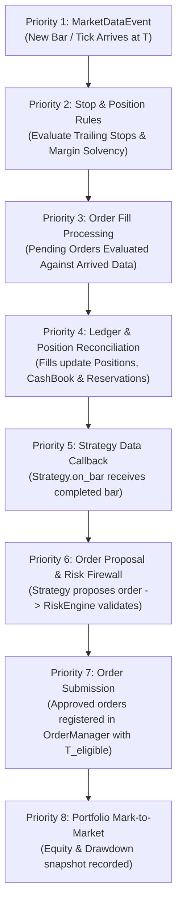
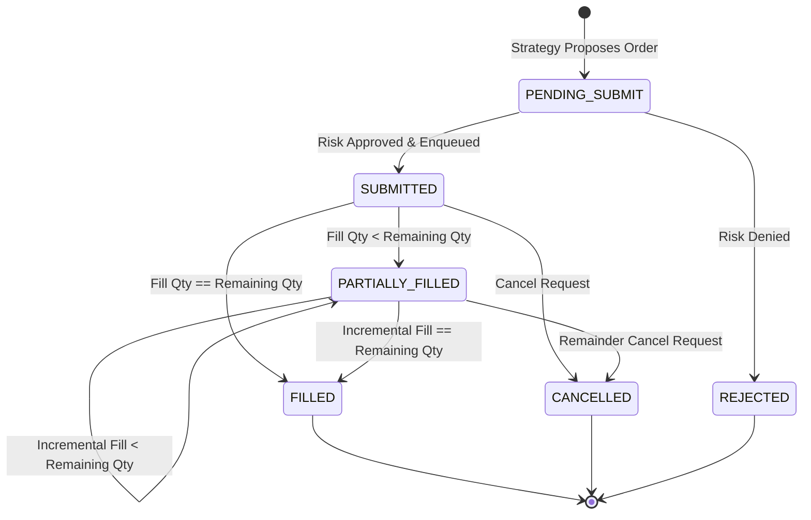
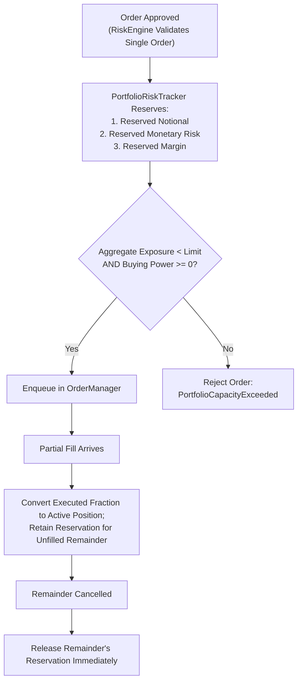
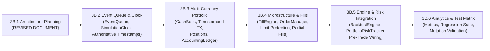

# Native Event-Driven Backtesting Engine: Architecture & Implementation Specification (Milestone 3B)

## Executive Summary

Following the empirical evaluation of Milestone 3A (documented in `docs/BACKTEST_EVALUATION.md`), we formally selected **Option B**: designing and building our own **native event-driven backtesting engine** within `hybrid-ai-trading-agent`.

This document establishes the comprehensive technical architecture, authoritative event-time semantics, execution price constraints, partial order lifecycles, instrument-specific accounting models, timestamped FX conversion, portfolio-level risk reservations, mathematical invariants, and test matrix for Milestone 3B.

### Core Architectural Directives
1. **Zero External Framework Coupling**: Built natively inside `src/hybrid_agent/execution/backtest/` without external backtesting dependencies.
2. **Domain Model Primacy**: Directly utilizes established domain models (`Bar`, `Tick`, `Order`, `InstrumentSpecification`, `DataProvenance`, `RiskEngine`).
3. **Strict Event-Time Causality**: Explicitly distinguishes bar start, bar end, data availability, strategy evaluation, order eligibility, and execution times. A bar only becomes available at its end time, and signals can never execute retrospectively.
4. **Deterministic Priority Queue**: Guarantees identical replay through a strictly ordered event queue prioritized by `(timestamp, priority, sequence_id)`. Events generated during dispatch are queued deterministically without retroactive re-ordering.
5. **Rigorous Fill Price Protection**: Limit order fills strictly satisfy price boundaries ($P_{\text{fill}} \le P_{\text{limit}}$ for BUY; $P_{\text{fill}} \ge P_{\text{limit}}$ for SELL). Microstructure spread and slippage models cannot violate limit constraints.
6. **Robust Partial Order Lifecycle**: Tracks original, filled, and remaining quantities, generating individual immutable execution records. Order cancellation releases only the unfilled remainder without altering established positions.
7. **Instrument-Specific Accounting**: Distinct accounting models for cash equities and linear margined contracts (CFDs), maintaining isolated multi-currency ledgers and reconciling every execution against double-entry ledger transactions.
8. **Timestamped FX Conversion**: Historical as-of currency conversion with maximum age thresholds, failing closed on stale or missing rates, and logging explicit ledger transactions for currency exchanges.
9. **Portfolio-Level Risk Reservations**: Bridges single-order `RiskEngine.evaluate_order()` with portfolio-wide tracking of open positions, pending orders, and reserved risk/buying power.

---

## 1. Supported Instrument Scope (Milestone 3B)

To avoid naive generalizations where cash equities, spot FX, CFDs, and futures are improperly conflated under a single accounting equation, Milestone 3B explicitly defines the supported instrument scope:

| Instrument Category | Milestone 3B Status | Valuation & Cash Model | Collateral / Margin Model |
| :--- | :---: | :--- | :--- |
| **Cash Equities / ETFs** | **Supported** | Fully funded linear asset. Buy debits $100\%$ notional cash + commission. Sell credits net proceeds. Long inventory held as asset shares. | No margin required. Buying power equals available cash in settlement currency. Shorting disabled without explicit borrowing model. |
| **Linear CFDs / Margined Contracts** | **Supported** | Derivative contract with linear quote-currency P&L. Trade does not debit full notional; debits only commission and financing. | Initial margin reserved from available equity: $\text{Notional} \times \text{MarginRate}$. Maintenance margin monitored. Fails closed if equity breaches margin. |
| **Spot Forex (Deliverable)** | **Deferred (Post-3B)** | Dual-currency cash balance exchange (e.g. sell USD to hold EUR). | Deferred to Milestone 4 to avoid conflating with margined CFD contracts. |
| **Futures (Daily Variation Margin)** | **Deferred (Post-3B)** | Daily mark-to-market settlement sweeps, exchange contract specs, expiry rolls. | Deferred to Milestone 4. |
| **Inverse Crypto Derivatives** | **Unsupported (Fail-Closed)** | Non-linear payoff ($1/P$). | Rejects with `UnsupportedValuationModelError`. |
| **Options & Non-Linear Derivatives** | **Unsupported (Fail-Closed)** | Non-linear Greeks, implied volatility surfaces, expiry decay. | Rejects with `UnsupportedValuationModelError`. |

---

## 2. Existing Source Code & Reusability Audit

An audit of the existing codebase confirms the reusable assets and required extensions:

| Module | Existing Components | Reusability Assessment & Required Extensions |
| :--- | :--- | :--- |
| `core/models.py` | `Bar`, `Tick`, `Quote`, `InstrumentSpecification`, `Order`, `Position`, `DataProvenance` | **100% Reusable**. `InstrumentSpecification` provides contract sizing, tick size, and currency metadata. `Order` provides lifecycle transitions. `Position` provides notional and monetary risk properties. |
| `core/constants.py` | `OrderSide`, `OrderType`, `OrderStatus`, `ValuationModel`, `ALLOWED_ORDER_TRANSITIONS` | **Extend Transitions**. Add `OrderStatus.PARTIALLY_FILLED` to `OrderStatus`. Update `ALLOWED_ORDER_TRANSITIONS` to support institutional partial fill lifecycles: `SUBMITTED -> PARTIALLY_FILLED -> FILLED/CANCELLED`. |
| `core/events.py` | `BaseEvent`, `MarketTickEvent`, `MarketBarEvent`, `SignalEvent`, `OrderProposalEvent`, `OrderApprovedEvent`, `OrderRejectedEvent` | **Reusable Base**. Add execution event DTOs: `OrderSubmittedEvent`, `OrderPartiallyFilledEvent`, `OrderFilledEvent`, `OrderCancelledEvent`, `PositionUpdatedEvent`, `PortfolioMarkedEvent`, `BacktestCompletedEvent`. |
| `execution/base.py` | `BaseBroker` | **Abstract Base**. Serves as the base interface that `BacktestBroker` implements to expose broker methods to strategies. |
| `risk/policy.py` | `RiskEngine`, `CurrencyConverter`, `SimpleFixedRateConverter`, `resolve_executable_price` | **Reusable Single-Order Firewall**. `RiskEngine` performs single-order rule evaluation. Portfolio-level aggregation is layered above it via `PortfolioRiskTracker`. |
| `config/settings.py` | `AppSettings`, `ExecutionMode` | **100% Reusable**. Provides risk limits (`max_daily_loss_pct`, `max_drawdown_limit_pct`, `max_risk_per_trade_pct`, `max_position_size_pct`). |
| `data/storage.py` | `ParquetStorageEngine`, `DuckDBAnalyticalEngine` | **Data Source**. Supplies historical `Bar` sequences partitioned by symbol and timeframe with validated half-open intervals `[start, end)`. |
| `features/pipeline.py` | `FeaturePipeline`, `StatefulIncrementalFeatureEngine` | **Feature Source**. Emits technical indicators causally with zero lookahead bias. |

---

## 3. Package Architecture: `src/hybrid_agent/execution/backtest/`

The engine is organized into focused, single-responsibility modules:

```
src/hybrid_agent/execution/backtest/
├── __init__.py               # Public API exports
├── engine.py                 # BacktestEngine coordinator & main simulation loop
├── event_queue.py            # Deterministic priority EventQueue (timestamp, priority, seq)
├── clock.py                  # SimulationClock strictly monotonic time manager
├── config.py                 # BacktestConfig immutable configuration data structure
├── portfolio.py              # Portfolio combining CashBook, PositionTracker & RiskTracker
├── cashbook.py               # Multi-currency CashBook with fail-closed FX conversion
├── currency.py               # TimestampedCurrencyConverter (as-of rate lookup & staleness checks)
├── positions.py              # PositionTracker (FIFO / average-cost inventory accounting)
├── order_manager.py          # Pending order queues, partial-fill state, bracket tracking & OCO
├── fill_engine.py            # Microstructure order matcher & fill evaluator
├── execution_models.py       # FillModel protocol & DefaultFillModel
├── spread.py                 # SpreadModel (Quote spread & explicit synthetic fallback)
├── slippage.py               # SlippageModel (Fixed, Spread, VolumeShare impact)
├── commission.py             # CommissionModel (PerTrade, PerShare, Percentage)
├── liquidity.py              # LiquidityModel (Volume participation caps)
├── risk_tracker.py           # PortfolioRiskTracker (aggregate exposure & pending reservations)
├── accounting.py             # AccountingLedger (immutable double-entry transaction record)
└── metrics.py                # PerformanceAnalyticsEngine (Sharpe, Drawdown, Expectancy)
```

### Module Responsibility Matrix

| Module | Primary Responsibility | Collaborators / Dependencies |
| :--- | :--- | :--- |
| `engine.py` | Coordinates timeline iteration, event dispatching, and run lifecycle. | `EventQueue`, `SimulationClock`, `Portfolio`, `OrderManager`, `FillEngine`, `PortfolioRiskTracker` |
| `event_queue.py` | Deterministic priority queue ordered by `(timestamp, priority, sequence_id)`. | `BaseEvent` hierarchy |
| `clock.py` | Maintains strictly monotonic simulation clock ($t_{\text{next}} \ge t_{\text{current}}$). | `datetime` (UTC) |
| `config.py` | Defines execution parameters, initial cash, cost models, spread assumptions, and policies. | `hybrid_agent.config.settings` |
| `cashbook.py` | Multi-currency cash ledger; executes explicit ledger conversions. | `TimestampedCurrencyConverter`, `AccountingLedger` |
| `currency.py` | Historical as-of FX converter with staleness thresholds and transaction cost tracking. | `CurrencyConverter` |
| `positions.py` | Tracks active positions, average entry prices, and realized/unrealized P&L. | `Position`, `InstrumentSpecification` |
| `portfolio.py` | Computes total equity, available buying power, margin usage, and notional exposure. | `CashBook`, `PositionTracker`, `PortfolioRiskTracker` |
| `risk_tracker.py` | Manages aggregate portfolio risk, pending order reservations, and margin limits. | `RiskEngine`, `OrderManager`, `Portfolio` |
| `order_manager.py` | Manages pending limit, stop, and bracket orders with partial fill lifecycle & OCO linking. | `Order`, `OrderStatus`, `ExecutionRecord` |
| `fill_engine.py` | Evaluates price conditions against bars/ticks and executes fills with limit price protection. | `FillModel`, `SpreadModel`, `SlippageModel`, `CommissionModel`, `LiquidityModel` |
| `execution_models.py`| Defines protocols and default logic for order fill verification. | `Bar`, `Tick`, `Order` |
| `spread.py` | Supplies bid/ask spread from top-of-book quotes or declared synthetic configuration. | `Tick`, `Quote`, `DataProvenance` |
| `slippage.py` | Calculates price adjustment due to market friction and size impact. | `Bar`, `Order` |
| `commission.py` | Computes broker commission and exchange fees per execution record. | `Order`, `ExecutionRecord` |
| `liquidity.py` | Enforces bar volume participation limits and calculates partial fills. | `Bar`, `Order` |
| `accounting.py` | Immutable transaction journal of all cash flows, fills, fees, and FX exchanges. | `OrderFilledEvent`, `CashBook`, `ExecutionRecord` |
| `metrics.py` | Calculates institutional risk-adjusted return and trade metrics. | `Portfolio`, `AccountingLedger` |

---

## 4. Authoritative Event-Time Semantics & Deterministic Lifecycle

### 4.1 Six Distinct Temporal Points
To eliminate retrospective execution and temporal ambiguity, every historical bar and order interaction distinguishes six distinct temporal milestones:

```
Timeline:
----+----------------------+--------------------+--------------------+--------------------+--->
    |                      |                    |                    |                    |
Bar Start              Bar End /           Strategy Eval        Order Eligible       Execution
T_start                Data Available      T_eval               T_eligible           T_exec
(Bar opens)            T_avail             (on_bar called)      (Next Bar Open)      (Fill created)
                       (Bar closes)
```

1. **Bar Start Time ($T_{\text{start}}$)**: The opening timestamp of the bar interval (e.g., `09:30:00` for a 5-minute bar).
2. **Bar End Time ($T_{\text{end}}$)**: The closing boundary timestamp of the bar interval (e.g., `09:35:00`). The bar interval is half-open: $[T_{\text{start}}, T_{\text{end}})$.
3. **Data Availability Time ($T_{\text{avail}}$)**: The earliest simulated time at which the complete bar becomes visible to the engine. For historical closed bars:
   $$T_{\text{avail}} = T_{\text{end}} + \delta_{\text{latency}} \quad (\delta_{\text{latency}} \ge 0)$$
   Under zero latency, $T_{\text{avail}} = T_{\text{end}}$. A bar is **never** available before $T_{\text{end}}$.
4. **Strategy Evaluation Time ($T_{\text{eval}}$)**: The timestamp at which the strategy's `on_bar()` handler evaluates the bar and technical features:
   $$T_{\text{eval}} \ge T_{\text{avail}} = T_{\text{end}}$$
5. **Order Eligibility Time ($T_{\text{eligible}}$)**: The earliest timestamp at which an emitted order can legally interact with the market matching engine:
   $$T_{\text{eligible}} \ge T_{\text{avail}} = T_{\text{end}}$$
   For bar-based strategies, orders are eligible for execution starting at the opening of the **subsequent** bar ($t+1$):
   $$T_{\text{eligible}} = T_{\text{start}, t+1} = T_{\text{end}, t}$$
6. **Execution Time ($T_{\text{exec}}$)**: The timestamp at which the fill actually occurs. For next-bar market orders:
   $$T_{\text{exec}} = T_{\text{start}, t+1}$$
   **Strict Invariant**: A trading signal computed from bar $t$ can **never** execute retrospectively at the opening price or closing price of bar $t$.

### 4.2 Intra-Timestamp Event Priority & Deterministic Sequencing

When multiple events share an identical timestamp $T$, the `EventQueue` dispatches them in strict deterministic priority order:



#### Deterministic Queue Sorting Tuple
Every event in the queue is prioritized by a three-element tuple:
$$\text{SortKey} = (\text{timestamp: datetime}, \text{priority: int}, \text{sequence\_id: int})$$
- `timestamp`: Monotonic UTC datetime.
- `priority`: Integer from 1 (Market Data) to 8 (Mark-to-Market).
- `sequence_id`: Auto-incrementing 64-bit integer assigned upon enqueueing, guaranteeing stable FIFO ordering among events sharing the same timestamp and priority.

#### Events Generated During Dispatch
If event dispatching at timestamp $T$ produces downstream events (e.g., an `OrderFilledEvent` at Priority 3 generates an `AccountingTransactionEvent` and `PositionUpdatedEvent` at Priority 4, or a strategy at Priority 5 emits an `OrderProposalEvent` at Priority 6):
1. **Never Inserted Retroactively**: An event generated during dispatch is enqueued with $\text{priority} \ge \text{current\_priority}$ (or scheduled for a future timestamp $T_{\text{future}} > T$).
2. **Stable Tie-Breaking**: Downstream events at the same timestamp receive a strictly higher `sequence_id` than any event already queued or processed.
3. **No Prior Step Disruption**: An event generated during dispatch cannot preempt or modify an event that has already been dispatched at Priority $\le \text{current\_priority}$.
4. **Temporal Monotonicity**: Enqueuing an event with $T_{\text{event}} < T_{\text{clock}}$ raises `TemporalOrderViolationError` immediately.

---

## 5. Execution Semantics, Fill Logic & Price Constraints

### 5.1 Price Taxonomy & Synthetic Spread Provenance
To avoid conflating quotes, trades, and model outputs:
- **Trade Price ($P_{\text{trade}}$)**: The recorded execution print from historical trades or bar Open/High/Low/Close.
- **Bid Price ($P_{\text{bid}}$)**: The highest price a buyer is willing to pay.
- **Ask Price ($P_{\text{ask}}$)**: The lowest price a seller is willing to accept.
- **Mid Price ($P_{\text{mid}}$)**: $(P_{\text{bid}} + P_{\text{ask}}) / 2$.
- **Modelled Execution Price ($P_{\text{fill}}$)**: The simulated execution price produced by applying spread, slippage, and price protection models.

#### Quote Fabrication Prohibition
- Historical bid/ask quotes must **never** be fabricated and falsely presented as real market observations.
- If historical data contains top-of-book quotes (`Quote`), the spread model uses real market quotes.
- If historical data contains only bars (`Bar`), synthetic spread assumptions must be explicitly configured in `BacktestConfig` (e.g. fixed basis points or minimum tick multiples) and recorded in execution metadata with `is_synthetic_quote=True` in data provenance.

### 5.2 Limit Order Price Protection Invariant
A limit order represents a strict guarantee of price boundary:
$$\text{BUY Limit Fill Constraint}: \quad P_{\text{fill}} \le P_{\text{limit}}$$
$$\text{SELL Limit Fill Constraint}: \quad P_{\text{fill}} \ge P_{\text{limit}}$$

- **Invariant Enforcement**: The spread model and slippage model **must not** cause these constraints to be violated.
- If $P_{\text{modelled}} = \text{BasePrice} + \frac{\text{Spread}}{2} + \text{Slippage} > P_{\text{limit}}$ for a BUY limit order, the order **cannot** fill at $P_{\text{modelled}}$. The fill engine will cap the fill price at $P_{\text{limit}}$ if the underlying market allowed execution at $P_{\text{limit}}$, or keep the order resting in the book as unfilled if the market did not reach executable liquidity within the limit.

### 5.3 Stop-Market vs Stop-Limit Semantics

| Parameter | Stop-Market Order | Stop-Limit Order |
| :--- | :--- | :--- |
| **Trigger Mechanism** | BUY triggers when Market $\ge P_{\text{stop}}$.<br>SELL triggers when Market $\le P_{\text{stop}}$. | BUY triggers when Market $\ge P_{\text{stop}}$.<br>SELL triggers when Market $\le P_{\text{stop}}$. |
| **Post-Trigger Order Type** | Converts to unconditional **Market Order**. | Converts to resting **Limit Order** with limit price $P_{\text{limit}}$. |
| **Gap-Through Behavior** | Executes at the opening price of the gapping bar ($\pm$ slippage). **Fills with adverse slippage**, capturing the full gap. | If bar opens beyond $P_{\text{limit}}$, order **does not fill**. It rests as an unfilled limit order awaiting market return to $\le P_{\text{limit}}$ (BUY) or $\ge P_{\text{limit}}$ (SELL). |
| **Execution Risk** | Price uncertainty (slippage risk). Execution guaranteed. | Price capped at $P_{\text{limit}}$. Execution NOT guaranteed (unfilled risk). |

### 5.4 Fill Execution Decision Table

| Order Type | Trigger Condition (Bar $t+1$) | Base Execution Price | Modelled Fill Price $P_{\text{fill}}$ | Price Protection Constraint |
| :--- | :--- | :--- | :--- | :--- |
| **Market BUY** | Unconditional at Bar Start | $\text{Open}_{t+1}$ | $\text{Open}_{t+1} + \frac{\text{Spread}}{2} + \text{Slippage}$ | None (Unconditional execution) |
| **Market SELL** | Unconditional at Bar Start | $\text{Open}_{t+1}$ | $\text{Open}_{t+1} - \frac{\text{Spread}}{2} - \text{Slippage}$ | None (Unconditional execution) |
| **Limit BUY** | $\text{Low}_{t+1} \le P_{\text{limit}}$ | $\min(\text{Open}_{t+1}, P_{\text{limit}})$ | $\min\left(P_{\text{limit}}, \text{BasePrice} + \frac{\text{Spread}}{2}\right)$ | **Strict**: $P_{\text{fill}} \le P_{\text{limit}}$ |
| **Limit SELL** | $\text{High}_{t+1} \ge P_{\text{limit}}$ | $\max(\text{Open}_{t+1}, P_{\text{limit}})$ | $\max\left(P_{\text{limit}}, \text{BasePrice} - \frac{\text{Spread}}{2}\right)$ | **Strict**: $P_{\text{fill}} \ge P_{\text{limit}}$ |
| **Stop-Market BUY** | $\text{High}_{t+1} \ge P_{\text{stop}}$ | $\max(\text{Open}_{t+1}, P_{\text{stop}})$ | $\text{BasePrice} + \frac{\text{Spread}}{2} + \text{Slippage}$ | Fills at Open if gapping above $P_{\text{stop}}$ |
| **Stop-Market SELL**| $\text{Low}_{t+1} \le P_{\text{stop}}$ | $\min(\text{Open}_{t+1}, P_{\text{stop}})$ | $\text{BasePrice} - \frac{\text{Spread}}{2} - \text{Slippage}$ | Fills at Open if gapping below $P_{\text{stop}}$ |
| **Stop-Limit BUY** | $\text{High}_{t+1} \ge P_{\text{stop}}$ AND $\text{Low}_{t+1} \le P_{\text{limit}}$ | $\min(\text{Open}_{t+1}, P_{\text{limit}})$ | $\min\left(P_{\text{limit}}, \text{BasePrice} + \frac{\text{Spread}}{2}\right)$ | **Strict**: $P_{\text{fill}} \le P_{\text{limit}}$; rests if $\text{Open} > P_{\text{limit}}$ |
| **Stop-Limit SELL**| $\text{Low}_{t+1} \le P_{\text{stop}}$ AND $\text{High}_{t+1} \ge P_{\text{limit}}$ | $\max(\text{Open}_{t+1}, P_{\text{limit}})$ | $\max\left(P_{\text{limit}}, \text{BasePrice} - \frac{\text{Spread}}{2}\right)$ | **Strict**: $P_{\text{fill}} \ge P_{\text{limit}}$; rests if $\text{Open} < P_{\text{limit}}$ |

### 5.5 Ambiguous Intrabar Execution (Conservative Stop-First Policy)
When a bar's price range $[\text{Low}, \text{High}]$ spans both the Stop-Loss price and Take-Profit price of an active bracket position:
- **Conservative Policy**: The engine assumes **Stop-Loss triggered first**.
- **Rationale**: In bar-level simulation without granular tick data, assuming Take-Profit executed first introduces severe positive survivor bias. The engine assumes the worst-case path: Stop-Loss executes at the stop price (or gapped open), and the Take-Profit is cancelled.

---

## 6. Partial Order Lifecycle & OCO Mechanics

### 6.1 Partial Fill State Machine



### 6.2 Partial Fill Invariants & Tracking
Every order tracks three explicit quantity attributes:
- `quantity`: Original requested quantity (immutable after approval).
- `filled_quantity`: Cumulative filled quantity across all execution events.
- `remaining_quantity`: Remaining unfilled quantity ($Q_{\text{remaining}} = Q_{\text{original}} - Q_{\text{filled}}$).

#### Mathematical Invariants
1. **Quantity Cap**: $0 \le Q_{\text{filled}} \le Q_{\text{original}}$ at all times. $Q_{\text{filled}}$ must **never** exceed $Q_{\text{original}}$.
2. **Individual Execution Records**: Every fill (partial or complete) creates an immutable `ExecutionRecord`:
   $$\text{ExecutionRecord} = (\text{exec\_id}, \text{order\_id}, \text{timestamp}, P_{\text{fill}}, Q_{\text{fill}}, \text{Commission}, \text{Slippage}, \text{LiquidityRole})$$
3. **Prorated Position & Ledger Updates**:
   - Each execution record updates the active position inventory immediately.
   - Weighted average entry price is updated:
     $$\overline{P}_{\text{new}} = \frac{Q_{\text{existing}} \cdot \overline{P}_{\text{existing}} + Q_{\text{fill}} \cdot P_{\text{fill}}}{Q_{\text{existing}} + Q_{\text{fill}}}$$
   - Commission is computed and debited strictly for $Q_{\text{fill}}$.
4. **Cancellation of Remainder**:
   - Cancelling a partially filled order transitions status to `OrderStatus.CANCELLED`.
   - **Position Preservation**: The accounting system must **never** erase or invalidate an existing partial position merely because the remainder of its parent order is cancelled.
   - **Reservation Release**: The cancellation releases only the risk reservation and buying power associated with $Q_{\text{remaining}}$.

### 6.3 One-Cancels-the-Other (OCO) Mechanics with Partial Fills
1. **Bracket Entry Partial Fills**:
   - When a bracket entry order is partially filled ($Q_{\text{filled}} < Q_{\text{original}}$), child exit orders (Take-Profit and Stop-Loss) are activated with their size set strictly to $Q_{\text{filled}}$, matching the executed position.
   - As subsequent partial fills arrive for the entry order, child order quantities are scaled up to match the new cumulative filled quantity.
2. **Bracket Exit Partial Fills**:
   - When an active Take-Profit or Stop-Loss exit order fills partially, the sibling exit order is **not** fully cancelled.
   - The sibling order's remaining quantity is reduced by the exact partial exit quantity:
     $$Q_{\text{sibling, remaining}} = Q_{\text{sibling, remaining}} - Q_{\text{exit, fill}}$$
   - Only when an exit order fills completely ($Q_{\text{remaining}} = 0$) is the sibling order cancelled in its entirety.

---

## 7. Instrument-Specific Accounting & Multi-Currency Ledger

### 7.1 Cash Equities Accounting Model (Fully Funded Linear)
- **Asset Nature**: Physical share ownership; fully funded (100% cash paid upfront).
- **Cash Impact**:
  - BUY: Cash balance in instrument settlement currency debited by $(Q_{\text{fill}} \times P_{\text{fill}} \times \text{ContractSize}) + \text{Commission}$.
  - SELL: Cash balance credited by $(Q_{\text{fill}} \times P_{\text{fill}} \times \text{ContractSize}) - \text{Commission}$.
- **Position Inventory**: Long shares held in inventory. Short positions require explicit stock loan borrowing (disabled by default in 3B).
- **Valuation**:
  $$\text{Position Value} = Q_{\text{shares}} \times P_{\text{current}} \times \text{ContractSize}$$
- **Realized P&L**:
  $$\text{Realized P\&L} = (P_{\text{sell}} - \overline{P}_{\text{entry}}) \times Q_{\text{sold}} \times \text{ContractSize} - \text{Commissions}_{\text{exit}}$$
- **Unrealized P&L**:
  $$\text{Unrealized P\&L} = (P_{\text{current}} - \overline{P}_{\text{entry}}) \times Q_{\text{pos}} \times \text{ContractSize}$$
- **Total Portfolio Equity**:
  $$\text{Equity}_{\text{base}} = \sum_{c \in \mathcal{C}} \text{FX}(C_c) + \sum_{p \in \mathcal{P}_{\text{equity}}} \text{FX}(\text{Position Value}_p)$$
  *Reconciliation Check*: Must equal $\text{Initial Cash} + \sum \text{Realized P\&L} + \sum \text{Unrealized P\&L} - \sum \text{Commissions} - \sum \text{Slippage}$.

### 7.2 Linear CFDs / Margined Contracts Accounting Model
- **Asset Nature**: Derivative contract with quote-currency cash settlement. Does not transfer full notional.
- **Collateral / Margin**:
  - Initial Margin reserved upon fill:
    $$\text{Margin}_{\text{used}} = \frac{Q_{\text{pos}} \times P_{\text{fill}} \times \text{ContractSize}}{\text{Leverage}} = \text{Notional} \times \text{MarginRate}$$
  - Maintenance Margin: Minimum required equity to keep position open:
    $$\text{Margin}_{\text{maintenance}} = \text{Notional} \times \text{MaintenanceMarginRate}$$
- **Cash Impact**:
  - Cash balance is **not** debited for full notional. Cash is debited only for `Commission` and financing/overnight swap fees.
  - Realized P&L from position closes is credited directly to Cash in `profit_currency`.
- **Unrealized P&L**:
  - Long: $(P_{\text{current}} - \overline{P}_{\text{entry}}) \times Q_{\text{pos}} \times \text{ContractSize}$
  - Short: $(\overline{P}_{\text{entry}} - P_{\text{current}}) \times Q_{\text{pos}} \times \text{ContractSize}$
- **Total Portfolio Equity**:
  $$\text{Equity}_{\text{base}} = \sum_{c \in \mathcal{C}} \text{FX}(C_c) + \sum_{p \in \mathcal{P}_{\text{cfd}}} \text{FX}(\text{Unrealized P\&L}_p)$$
- **Free Margin / Available Buying Power**:
  $$\text{Free Margin} = \text{Equity}_{\text{base}} - \text{Margin}_{\text{used, base}} - \text{Reserved Risk}_{\text{pending}}$$

---

## 8. Timestamped Currency Conversion & Ledger Tracking

### 8.1 TimestampedCurrencyConverter Specification
For historical simulation, dynamic conversion replaces fixed static rates:

```python
class TimestampedCurrencyConverter(Protocol):
    def convert(
        self,
        from_amount: Decimal,
        from_currency: str,
        to_currency: str,
        as_of: datetime,
        max_age: timedelta | None = None
    ) -> ConversionResult: ...
```

### 8.2 Operational Rules
1. **As-Of Lookup**: For conversion at timestamp $T_{\text{as\_of}}$, looks up the latest historical FX observation $(T_{\text{rate}}, \text{Pair}, \text{Rate})$ where $T_{\text{rate}} \le T_{\text{as\_of}}$.
2. **Maximum Permitted Observation Age**: If $T_{\text{as\_of}} - T_{\text{rate}} > \Delta T_{\text{max}}$ (configurable in `BacktestConfig`, default 24 hours for daily, 1 hour for intraday), the engine **fails closed** and raises `StaleFXRateError`.
3. **Missing Rate**: If no rate exists between `from_currency` and `to_currency` (or via base currency triangulation), the engine **fails closed** and raises `MissingFXRateError`.
4. **Treatment of Currency Balances**:
   - **Positive Balances**: Asset held in currency $c$, translated to base equity.
   - **Negative Balances**: Tracked as explicit liability debits in currency $c$, translated at current FX rate with potential debit interest charges applied.
5. **Explicit Ledger Transactions for FX Conversion**:
   - Automatic currency conversion must **never silently create or adjust currency balances**.
   - Every currency conversion produces an explicit `FXConversionTransaction` in `AccountingLedger`:
     $$\text{FXTransaction} = (\text{tx\_id}, \text{timestamp}, \text{from\_curr}, \text{to\_curr}, \text{from\_amt}, \text{to\_amt}, \text{rate}, \text{fee})$$

---

## 9. Portfolio-Level Risk Reservations & Pre-Trade Firewall

### 9.1 Distinction Between RiskEngine and PortfolioRiskTracker
- **`RiskEngine.evaluate_order()`**: Evaluates an individual order against single-order rules: maximum risk per trade, maximum single order notional, minimum stop distance, valid reference price. It does **not** maintain active state across the entire portfolio.
- **`PortfolioRiskTracker`**: Maintains aggregate portfolio-level risk state:
  - Aggregate open position notional and monetary risk.
  - Active pending order reservations.
  - Available buying power and free margin.
  - Total portfolio exposure limits.

### 9.2 Pending Order Risk Reservations



#### Reservation Rules
1. **Approval Reservation**: When an order is approved, `PortfolioRiskTracker` reserves:
   - $\text{Reserved Notional} = Q_{\text{remaining}} \times P_{\text{limit/ref}} \times \text{ContractSize}$
   - $\text{Reserved Monetary Risk} = Q_{\text{remaining}} \times |P_{\text{ref}} - P_{\text{stop}}| \times \text{ContractSize}$
   - $\text{Reserved Margin} = \text{Reserved Notional} \times \text{MarginRate}$
2. **Partial Fill Update**: Upon a partial fill of quantity $Q_{\text{fill}}$, the executed fraction is transferred from reserved to active position margin/risk:
   $$\text{Reserved Notional}_{\text{new}} = \text{Reserved Notional}_{\text{old}} \times \frac{Q_{\text{remaining}} - Q_{\text{fill}}}{Q_{\text{remaining}}}$$
3. **Cancellation Release**: When an order (or its remaining portion) is cancelled, the corresponding reservation is released immediately into free buying power.

---

## 10. Look-Ahead and Causality Protection

### 10.1 Temporal Boundaries
1. Strategies receive completed historical bars only after `bar.end_time` has elapsed.
2. An order created at bar $t$ cannot fill during bar $t$.
3. Feature calculations must use `StatefulIncrementalFeatureEngine` or causal slice indexing.

### 10.2 Mutation Verification Test Protocol
To formally verify zero lookahead bias:
1. Run backtest on baseline dataset ($T_0 \to T_{100}$). Record all strategy decisions, submitted orders, execution fill records, portfolio equity states, and risk decisions up to $T_{50}$.
2. Create mutated dataset where bars from $T_{51} \to T_{100}$ have prices doubled, halved, or randomized.
3. Re-run backtest on mutated dataset.
4. **Pass Criteria**: Every single decision, submitted order, fill price, fill quantity, fee, risk reservation, and portfolio equity up to $T_{50}$ must match the baseline bit-for-bit.

---

## 11. Performance Analytics Engine

The `PerformanceAnalyticsEngine` computes standardized institutional metrics:

### Return Metrics
- **Total Return**: $\frac{\text{Ending Equity} - \text{Initial Cash}}{\text{Initial Cash}}$
- **CAGR**: $\left(\frac{\text{Ending Equity}}{\text{Initial Cash}}\right)^{\frac{365.25}{\text{Days}}} - 1$
- **Annualized Volatility**: $\sigma_{\text{daily}} \times \sqrt{252}$

### Risk-Adjusted Ratios
- **Sharpe Ratio**: $\sqrt{252} \times \frac{\overline{R_d} - R_f}{\sigma_d}$
- **Sortino Ratio**: $\sqrt{252} \times \frac{\overline{R_d} - R_f}{\sigma_{\text{downside}}}$, where $\sigma_{\text{downside}} = \sqrt{\frac{1}{N}\sum \min(R_d - R_f, 0)^2}$
- **Calmar Ratio**: $\frac{\text{CAGR}}{|\text{Max Drawdown}|}$
- **Maximum Drawdown**: $\max_{t} \left(\frac{\text{HWM}_t - \text{Equity}_t}{\text{HWM}_t}\right)$

### Trade Performance
- **Win Rate**: $\frac{N_{\text{winning}}}{N_{\text{total}}}$
- **Profit Factor**: $\frac{\sum \text{Gross Profits}}{\sum |\text{Gross Losses}|}$
- **Expectancy**: $(\text{Win Rate} \times \overline{\text{Win}}) - (\text{Loss Rate} \times \overline{\text{Loss}})$
- **Payoff Ratio**: $\frac{\overline{\text{Win}}}{\overline{\text{Loss}}}$

### Microstructure Friction Metrics
- **Total Commission Paid**: $\sum \text{Commission}$
- **Total Slippage Paid**: $\sum \text{Slippage} \times Q \times \text{ContractSize}$
- **Turnover**: $\frac{\text{Total Traded Volume (\text{Notional})}}{\text{Average Portfolio Equity}}$

---

## 12. Final Open-Position Policy

At the conclusion of the backtest simulation:
- **No Forced Liquidation**: Open positions are **NOT** artificially closed or liquidated.
- **Mark-to-Market Valuation**: All open positions are marked to market using the final bar's Close price (or latest Quote mid).
- **Segregated Reporting**: Reporting displays Realized P&L (closed trades) and Unrealized P&L (open positions) distinctly, ensuring transparency.

---

## 13. Implementation Sequence (Milestones 3B.1 to 3B.6)



### Detailed Breakdown of Sub-Milestones
- **Milestone 3B.1 (Architecture Planning — Current)**: Completed and revised architectural specification addressing all review points.
- **Milestone 3B.2 (Event Queue & Clock)**: Implement `EventQueue`, `SimulationClock`, and execution event DTOs. Verify strictly monotonic event dispatch, tie-breaking sequence IDs, and non-retroactive dispatch.
- **Milestone 3B.3 (Multi-Currency Portfolio & CashBook)**: Implement `CashBook`, `TimestampedCurrencyConverter`, `PositionTracker`, `PortfolioRiskTracker`, and `AccountingLedger`. Verify multi-currency cash flows, FIFO/average cost, margin reservations, and fail-closed FX conversion.
- **Milestone 3B.4 (Execution Models & Fill Engine)**: Implement `FillEngine`, `OrderManager`, `SpreadModel`, `SlippageModel`, `CommissionModel`, `LiquidityModel`. Verify gap open fills, limit price protection, conservative stop-first resolution, and partial fills.
- **Milestone 3B.5 (Engine Coordinator & Risk Integration)**: Implement `BacktestEngine`, `BacktestConfig`, and wire pre-trade `RiskEngine` with `PortfolioRiskTracker`. Verify next-bar execution causality and reservation releases.
- **Milestone 3B.6 (Analytics, Verification Suite & Documentation)**: Implement `PerformanceAnalyticsEngine`, full integration test suite, mutation-based lookahead tests, and update development status.

---

## 14. Comprehensive Verification & Regression Test Matrix

| Component | Test File | Test Case Name | Target Behavior Verified |
| :--- | :--- | :--- | :--- |
| **Clock** | `test_clock.py` | `test_monotonic_clock_advance` | Clock advances forward monotonically; raises `TemporalOrderViolationError` on backward timestamp. |
| **EventQueue** | `test_event_queue.py` | `test_deterministic_priority_ordering` | Events with identical timestamps sort deterministically by priority (1 to 8) and sequence ID. |
| **EventQueue** | `test_event_queue.py` | `test_dispatch_generated_events_ordering` | Events generated during dispatch are queued with higher sequence IDs and never inserted retroactively. |
| **EventQueue** | `test_event_queue.py` | `test_prevent_time_reversal` | Enqueuing an event older than current clock raises `TemporalOrderViolationError`. |
| **Currency** | `test_currency.py` | `test_timestamped_fx_as_of_lookup` | Retrieves the latest valid FX rate where $T_{\text{rate}} \le T_{\text{as\_of}}$. |
| **Currency** | `test_currency.py` | `test_fail_closed_stale_fx_rate` | Rates older than $\Delta T_{\text{max}}$ raise `StaleFXRateError`. |
| **Currency** | `test_currency.py` | `test_fail_closed_missing_fx_rate` | Missing currency conversion pair raises `MissingFXRateError`. |
| **CashBook** | `test_cashbook.py` | `test_multi_currency_balances` | Tracks isolated currency balances without nominal blending. |
| **CashBook** | `test_cashbook.py` | `test_negative_currency_balance_handling`| Explicitly tracks negative currency balance liabilities and logs conversion transactions. |
| **CashBook** | `test_cashbook.py` | `test_explicit_fx_ledger_transaction` | Currency conversion creates explicit `FXConversionTransaction` in `AccountingLedger`. |
| **Positions** | `test_positions.py` | `test_cash_equity_accounting_reconciliation` | Full notional cash debit, share inventory, commission deduction, and equity reconciliation. |
| **Positions** | `test_positions.py` | `test_linear_cfd_margin_accounting` | Reserved margin tracking, quote-currency P&L cash credit, and maintenance margin check. |
| **Positions** | `test_positions.py` | `test_average_entry_price_scaling` | Weighted average entry price correctly calculated across scaled entries. |
| **Positions** | `test_positions.py` | `test_end_of_backtest_open_position_valuation` | Positions remain open at simulation end, marked to market without artificial liquidation. |
| **OrderManager** | `test_order_manager.py`| `test_partial_fill_remainder_lifecycle` | Order fills partially; filled quantity recorded; unfilled remainder stays pending with prorated risk. |
| **OrderManager** | `test_order_manager.py`| `test_partial_fill_cancellation_preserves_position` | Cancelling order remainder releases reservation but preserves existing partial position inventory. |
| **OrderManager** | `test_order_manager.py`| `test_bracket_oco_cancellation` | When Take-Profit fills completely, Stop-Loss is automatically cancelled, and vice-versa. |
| **OrderManager** | `test_order_manager.py`| `test_bracket_oco_partial_fill_scaling` | When Take-Profit fills partially, Stop-Loss quantity is reduced proportionally without premature cancellation. |
| **FillEngine** | `test_fill_engine.py` | `test_next_bar_open_fill_causality` | Market orders fill at bar $t+1$ Open ($T_{\text{exec}} = T_{\text{start}, t+1}$), never bar $t$ Close. |
| **FillEngine** | `test_fill_engine.py` | `test_buy_limit_price_protection` | BUY limit fills at $\le P_{\text{limit}}$; spread/slippage models cannot cause fill $> P_{\text{limit}}$. |
| **FillEngine** | `test_fill_engine.py` | `test_sell_limit_price_protection` | SELL limit fills at $\ge P_{\text{limit}}$;\ spread/slippage models cannot cause fill $< P_{\text{limit}}$. |
| **FillEngine** | `test_fill_engine.py` | `test_stop_market_gap_open_execution`| Stop-market fills at gapped Open price + slippage, capturing the adverse price gap. |
| **FillEngine** | `test_fill_engine.py` | `test_stop_limit_gap_protection` | Stop-limit triggers on stop price but remains unfilled if market gaps beyond limit price. |
| **FillEngine** | `test_fill_engine.py` | `test_conservative_stop_first_ambiguity`| Bar touching both SL and TP executes Stop-Loss first (worst-case assumption). |
| **RiskTracker** | `test_risk_tracker.py` | `test_pending_order_risk_reservation` | Approved orders reserve buying power and risk; subsequent orders reject if aggregate exposure breached. |
| **RiskTracker** | `test_risk_tracker.py` | `test_cancellation_releases_reservation`| Cancelling pending order immediately restores reserved buying power and exposure capacity. |
| **Accounting** | `test_accounting.py` | `test_multiple_fills_fee_reconciliation`| Every execution record reconciles to cash deductions and ledger journal entries. |
| **Causality** | `test_causality.py` | `test_future_mutation_invariance` | Mutating future bars produces bit-for-bit identical historical decisions, orders, fills, and equity. |
| **Analytics** | `test_metrics.py` | `test_institutional_performance_metrics`| Sharpe, Sortino, Calmar, Max Drawdown, and Expectancy reconcile with reference math. |
