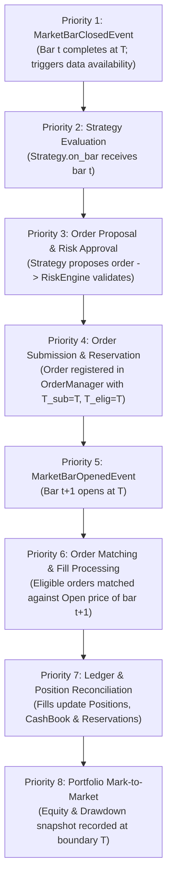
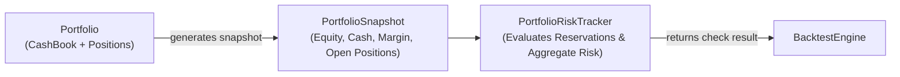
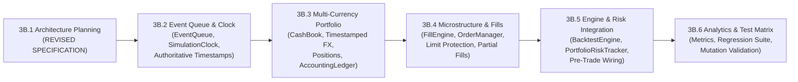

# Native Event-Driven Backtesting Engine: Architecture & Implementation Specification (Milestone 3B)

## Executive Summary

Following the empirical evaluation of Milestone 3A (documented in `docs/BACKTEST_EVALUATION.md`), we formally selected **Option B**: designing and building our own **native event-driven backtesting engine** within `hybrid-ai-trading-agent`.

This document establishes the comprehensive technical architecture, authoritative event-time semantics, execution price constraints, partial order lifecycles, instrument-specific accounting models, timestamped FX conversion, portfolio-level risk reservations, mathematical invariants, domain model extensions, and test matrix for Milestone 3B.

### Core Architectural Directives
1. **Zero External Framework Coupling**: Built natively inside `src/hybrid_agent/execution/backtest/` without external backtesting dependencies.
2. **Domain Model Primacy with Dedicated Execution Wrappers**: Preserves core domain models (`Bar`, `Tick`, `Order`, `InstrumentSpecification`, `DataProvenance`, `RiskEngine`) while introducing lightweight backtest execution wrappers (`OrderExecutionState`, `InstrumentBacktestProfile`) to track execution lifecycle, margin rates, and partial fills without polluting core models.
3. **Authoritative Event-Time Causality**: Explicitly distinguishes bar start, bar end, data availability, strategy evaluation, order proposal, risk approval, order submission, order eligibility, matching, and fill execution. A bar only becomes available at its end time, and signals can never execute retrospectively.
4. **Deterministic Priority Queue**: Guarantees identical replay through a strictly ordered event queue prioritized by `(timestamp, priority, sequence_id)`. Events generated during dispatch are queued deterministically without retroactive re-ordering.
5. **Rigorous Fill Price Protection**: Limit order fills strictly satisfy price boundaries ($P_{\text{fill}} \le P_{\text{limit}}$ for BUY; $P_{\text{fill}} \ge P_{\text{limit}}$ for SELL) under both real quote and synthetic spread models.
6. **Conservative Stop-Limit & Intrabar Ambiguity**: Ambiguous bar-only stop-limit paths remain unfilled unless subsequent bars confirm post-trigger execution. Volatile candles touching both stop-loss and take-profit default to conservative stop-first execution.
7. **Robust Partial Order Lifecycle**: Tracks original, filled, and remaining quantities, generating individual immutable execution records. Order cancellation releases only the unfilled remainder without altering established positions.
8. **Instrument-Specific Accounting**: Distinct accounting models for cash equities and linear margined contracts (CFDs), maintaining isolated multi-currency ledgers and reconciling every execution without double-counting commissions or embedded spreads.
9. **Timestamped FX Conversion**: Historical as-of currency conversion with maximum age thresholds, failing closed on stale or missing rates, distinguishing valuation translation from actual currency exchanges.
10. **Decoupled Portfolio Risk & Margin Reservations**: Separates cash equity buying power, CFD free margin, and portfolio risk budget capacity into distinct accounting reservations, integrating with the pre-trade `RiskEngine` via clock-bound adapters.

---

## 1. Supported Instrument Scope (Milestone 3B)

To avoid naive generalizations where cash equities, spot FX, CFDs, and futures are improperly conflated under a single accounting equation, Milestone 3B explicitly defines the supported instrument scope:

| Instrument Category | Milestone 3B Status | Valuation & Cash Model | Collateral / Margin Model |
| :--- | :---: | :--- | :--- |
| **Cash Equities / ETFs** | **Supported** | Fully funded linear asset. Buy debits $100\%$ notional cash + commission. Sell credits net proceeds. Long inventory held as asset shares. | No margin required. Buying power equals available cash in settlement currency minus pending cash reservations. Shorting disabled without explicit borrowing model. |
| **Linear CFDs / Margined Contracts** | **Supported** | Derivative contract with linear quote-currency P&L. Trade does not debit full notional; debits only commission and financing. | Initial margin reserved from available equity: $\text{Notional} \times \text{MarginRate}$. Maintenance margin monitored. Fails closed if equity breaches margin. |
| **Spot Forex (Deliverable)** | **Deferred (Post-3B)** | Dual-currency cash balance exchange (e.g. sell USD to hold EUR). | Deferred to Milestone 4 to avoid conflating with margined CFD contracts. |
| **Futures (Daily Variation Margin)** | **Deferred (Post-3B)** | Daily mark-to-market settlement sweeps, exchange contract specs, expiry rolls. | Deferred to Milestone 4. |
| **Inverse Crypto Derivatives** | **Unsupported (Fail-Closed)** | Non-linear payoff ($1/P$). | Rejects with `UnsupportedValuationModelError`. |
| **Options & Non-Linear Derivatives** | **Unsupported (Fail-Closed)** | Non-linear Greeks, implied volatility surfaces, expiry decay. | Rejects with `UnsupportedValuationModelError`. |

---

## 2. Existing Source Code & Reusability Audit

An audit of the existing codebase confirms the reusable assets and the deliberate boundary between core domain models and backtesting wrappers:

| Module | Existing Components | Reusability Assessment & Execution Architecture |
| :--- | :--- | :--- |
| `core/models.py` | `Bar`, `Tick`, `Quote`, `InstrumentSpecification`, `Order`, `Position`, `DataProvenance` | **100% Reusable Base**. Core `Order` and `InstrumentSpecification` remain clean. Backtesting introduces `OrderExecutionState` and `InstrumentBacktestProfile` wrappers to manage partial fills, margin rates, and bracket linkages. |
| `core/constants.py` | `OrderSide`, `OrderType`, `OrderStatus`, `ValuationModel`, `ALLOWED_ORDER_TRANSITIONS` | **Core Constants Preserved**. Domain `OrderType` (`MARKET`, `LIMIT`, `STOP_LOSS`) is mapped in backtest execution state to fine-grained matching classifications: `MARKET`, `LIMIT`, `STOP_MARKET`, and `STOP_LIMIT`. |
| `core/events.py` | `BaseEvent`, `MarketTickEvent`, `MarketBarEvent`, `SignalEvent`, `OrderProposalEvent`, `OrderApprovedEvent`, `OrderRejectedEvent` | **Reusable Base**. Add execution event DTOs: `MarketBarClosedEvent`, `MarketBarOpenedEvent`, `OrderSubmittedEvent`, `OrderPartiallyFilledEvent`, `OrderFilledEvent`, `OrderCancelledEvent`, `PositionUpdatedEvent`, `PortfolioMarkedEvent`, `BacktestCompletedEvent`. |
| `execution/base.py` | `BaseBroker` | **Abstract Base**. Serves as the base interface that `BacktestBroker` implements to expose broker methods to strategies. |
| `risk/policy.py` | `RiskEngine`, `CurrencyConverter`, `SimpleFixedRateConverter`, `resolve_executable_price` | **Reusable Single-Order Firewall**. `RiskEngine` evaluates individual orders. `PortfolioRiskTracker` manages aggregate portfolio risk and reservations. `BacktestCurrencyAdapter` connects `RiskEngine` to historical timestamped FX. |
| `config/settings.py` | `AppSettings`, `ExecutionMode` | **100% Reusable**. Provides risk limits (`max_daily_loss_pct`, `max_drawdown_limit_pct`, `max_risk_per_trade_pct`, `max_position_size_pct`). |
| `data/storage.py` | `ParquetStorageEngine`, `DuckDBAnalyticalEngine` | **Data Source**. Supplies historical `Bar` sequences partitioned by symbol and timeframe with validated half-open intervals `[start, end)`. |
| `features/pipeline.py` | `FeaturePipeline`, `StatefulIncrementalFeatureEngine` | **Feature Source**. Emits technical indicators causally with zero lookahead bias. |

---

## 3. Package Architecture: `src/hybrid_agent/execution/backtest/`

The engine is organized into focused, single-responsibility modules:

```
src/hybrid_agent/execution/backtest/
├── __init__.py               # Public API exports
├── engine.py                 # BacktestEngine coordinator & main simulation loop
├── event_queue.py            # Deterministic priority EventQueue (timestamp, priority, seq)
├── clock.py                  # SimulationClock strictly monotonic time manager
├── config.py                 # BacktestConfig immutable configuration data structure
├── state.py                  # OrderExecutionState & InstrumentBacktestProfile wrappers
├── portfolio.py              # Portfolio combining CashBook, PositionTracker & RiskTracker
├── cashbook.py               # Multi-currency CashBook with explicit ledger transactions
├── currency.py               # TimestampedCurrencyConverter & BacktestCurrencyAdapter
├── financing.py              # FinancingModel protocol & DailyFinancingModel for CFDs
├── positions.py              # PositionTracker (FIFO / average-cost inventory accounting)
├── order_manager.py          # Pending order queues, partial-fill state, bracket tracking & OCO
├── fill_engine.py            # Microstructure order matcher with limit protection
├── execution_models.py       # FillModel protocol & DefaultFillModel
├── spread.py                 # SpreadModel (Quote spread & explicit synthetic fallback)
├── slippage.py               # SlippageModel (Fixed, Spread, VolumeShare impact)
├── commission.py             # CommissionModel (PerTrade, PerShare, Percentage)
├── liquidity.py              # LiquidityModel (Volume participation caps)
├── risk_tracker.py           # PortfolioRiskTracker (aggregate exposure & pending reservations)
├── accounting.py             # AccountingLedger (immutable double-entry transaction record)
└── metrics.py                # PerformanceAnalyticsEngine (Sharpe, Drawdown, Expectancy)
```

### Module Responsibility Matrix

| Module | Primary Responsibility | Collaborators / Dependencies |
| :--- | :--- | :--- |
| `engine.py` | Coordinates timeline iteration, event dispatching, and run lifecycle. | `EventQueue`, `SimulationClock`, `Portfolio`, `OrderManager`, `FillEngine`, `PortfolioRiskTracker` |
| `event_queue.py` | Deterministic priority queue ordered by `(timestamp, priority, sequence_id)`. | `BaseEvent` hierarchy |
| `clock.py` | Maintains strictly monotonic simulation clock ($t_{\text{next}} \ge t_{\text{current}}$). | `datetime` (UTC) |
| `config.py` | Defines execution parameters, initial cash, cost models, spread assumptions, and policies. | `hybrid_agent.config.settings` |
| `state.py` | Holds `OrderExecutionState` and `InstrumentBacktestProfile` wrappers. | `Order`, `InstrumentSpecification`, `ExecutionRecord` |
| `cashbook.py` | Multi-currency cash ledger; executes explicit ledger conversions. | `TimestampedCurrencyConverter`, `AccountingLedger` |
| `currency.py` | Historical as-of FX converter with staleness thresholds and clock-bound adapter for `RiskEngine`. | `CurrencyConverter`, `SimulationClock` |
| `financing.py` | Computes overnight holding costs for margined CFDs. | `InstrumentBacktestProfile`, `Position` |
| `positions.py` | Tracks active positions, average entry prices, and realized/unrealized P&L. | `Position`, `InstrumentSpecification` |
| `portfolio.py` | Computes total equity, available buying power, margin usage, and notional exposure. | `CashBook`, `PositionTracker`, `PortfolioRiskTracker` |
| `risk_tracker.py` | Manages aggregate portfolio risk, pending order reservations, and margin limits. | `RiskEngine`, `OrderManager`, `PortfolioSnapshot` |
| `order_manager.py` | Manages pending limit, stop, and bracket orders with partial fill lifecycle & OCO linking. | `OrderExecutionState`, `OrderStatus` |
| `fill_engine.py` | Evaluates price conditions against bars/ticks and executes fills with limit price protection. | `FillModel`, `SpreadModel`, `SlippageModel`, `CommissionModel`, `LiquidityModel` |
| `execution_models.py`| Defines protocols and default logic for order fill verification. | `Bar`, `Tick`, `OrderExecutionState` |
| `spread.py` | Supplies bid/ask spread from top-of-book quotes or declared synthetic configuration. | `Tick`, `Quote`, `DataProvenance` |
| `slippage.py` | Calculates price adjustment due to market friction and size impact. | `Bar`, `OrderExecutionState` |
| `commission.py` | Computes broker commission and exchange fees per execution record. | `OrderExecutionState`, `ExecutionRecord` |
| `liquidity.py` | Enforces bar volume participation limits and calculates partial fills. | `Bar`, `OrderExecutionState` |
| `accounting.py` | Immutable transaction journal of all cash flows, fills, fees, and FX exchanges. | `OrderFilledEvent`, `CashBook`, `ExecutionRecord` |
| `metrics.py` | Calculates institutional risk-adjusted return and trade metrics. | `Portfolio`, `AccountingLedger` |

---

## 4. Authoritative Event-Time Semantics & Deterministic Lifecycle

### 4.1 Explicit Timeline Milestones
To eliminate retrospective execution and temporal ambiguity, every historical bar and order interaction distinguishes the following temporal milestones:

```
Timeline:
----+----------------------+--------------------+--------------------+--------------------+--->
    |                      |                    |                    |                    |
Bar Start              Bar End /           Strategy Eval        Order Submission     Order Execution
T_start                Data Available      T_eval               T_submission         T_exec
(Bar opens)            T_avail             (on_bar called)      (Registered in OM)   (Fill created)
                       (Bar closes)
```

1. **Bar Start Time ($T_{\text{start}}$)**: The opening timestamp of the bar interval (e.g., `09:30:00` for a 5-minute bar).
2. **Bar End Time ($T_{\text{end}}$)**: The closing boundary timestamp of the bar interval (e.g., `09:35:00`). The bar interval is half-open: $[T_{\text{start}}, T_{\text{end}})$.
3. **Data Availability Time ($T_{\text{avail}}$)**: The earliest simulated time at which the complete bar becomes visible to the engine:
   $$T_{\text{avail}} = T_{\text{end}} + \delta_{\text{latency}} \quad (\delta_{\text{latency}} \ge 0)$$
   Under zero latency, $T_{\text{avail}} = T_{\text{end}}$. A bar is **never** available before $T_{\text{end}}$.
4. **Strategy Evaluation Time ($T_{\text{eval}}$)**: The timestamp at which the strategy's `on_bar()` handler evaluates the bar and technical features:
   $$T_{\text{eval}} \ge T_{\text{avail}}$$
5. **Order Proposal Time ($T_{\text{proposal}}$)**: The timestamp at which the strategy emits an order proposal:
   $$T_{\text{proposal}} = T_{\text{eval}}$$
6. **Risk Approval Time ($T_{\text{approval}}$)**: The timestamp at which the pre-trade risk firewall evaluates and approves the order:
   $$T_{\text{approval}} \ge T_{\text{proposal}}$$
7. **Order Submission Time ($T_{\text{submission}}$)**: The explicit timestamp at which the approved order is registered with the `OrderManager`:
   $$T_{\text{submission}} \ge T_{\text{approval}}$$
8. **Order Eligibility Time ($T_{\text{eligible}}$)**: The earliest timestamp at which an order can legally interact with market matching:
   $$T_{\text{eligible}} \ge \max(T_{\text{avail}}, T_{\text{eval}}, T_{\text{submission}})$$
9. **Order Matching Time ($T_{\text{match}}$)**: The timestamp of the market event against which the order is evaluated.
10. **Execution Time ($T_{\text{exec}}$)**: The timestamp at which a fill occurs. Must strictly satisfy:
    $$T_{\text{exec}} \ge T_{\text{submission}}$$

### 4.2 Next-Bar-Open Execution Contract and Latency Reconcilement
- **Eligible Next-Bar Open Execution**: When data latency is zero ($\delta_{\text{latency}} = 0$) and strategy evaluation is immediate at bar boundary $T$ ($T_{\text{end}, t} = T_{\text{start}, t+1} = T$):
  $$T_{\text{submission}} = T \le T_{\text{start}, t+1} \implies \text{Order is eligible to fill at } \text{Open}_{t+1}$$
- **Delayed Order Submission (No Retrospective Backdating)**: When positive data latency ($\delta_{\text{latency}} > 0$) or strategy computation delay causes:
  $$T_{\text{submission}} > T_{\text{start}, t+1}$$
  the opening price of bar $t+1$ has already elapsed in market time. **The order cannot fill at $\text{Open}_{t+1}$**. It remains resting in the `OrderManager` and is evaluated against the next genuinely executable market event (e.g., intraday ticks during bar $t+1$, or the opening of bar $t+2$). Retrospective execution is strictly forbidden.

### 4.3 Deterministic Priority Queue & Simultaneous Boundary Handling

When a bar close and subsequent bar open share the identical boundary timestamp $T$ ($T_{\text{end}, t} = T_{\text{start}, t+1} = T$), the `EventQueue` dispatches events in strict, immutable priority order:



#### Deterministic Queue Sorting Tuple
Every event in the queue is prioritized by a three-element tuple:
$$\text{SortKey} = (\text{timestamp: datetime}, \text{priority: int}, \text{sequence\_id: int})$$
- `timestamp`: Monotonic UTC datetime.
- `priority`: Integer from 1 to 8.
- `sequence_id`: Auto-incrementing 64-bit integer assigned upon enqueueing, guaranteeing stable FIFO ordering among events sharing the same timestamp and priority.

#### Events Generated During Dispatch
If event dispatching at timestamp $T$ produces downstream events (e.g., a strategy callback at Priority 2 proposes an order at Priority 3):
1. **Never Inserted Retroactively**: An event generated during dispatch is enqueued with $\text{priority} \ge \text{current\_priority}$ (or scheduled for a future timestamp $T_{\text{future}} > T$).
2. **Stable Tie-Breaking**: Downstream events at the same timestamp receive a strictly higher `sequence_id` than any event already queued or processed.
3. **No Prior Step Disruption**: An event generated during dispatch cannot preempt or modify an event that has already been dispatched at Priority $\le \text{current\_priority}$.
4. **Temporal Monotonicity**: Enqueuing an event with $T_{\text{event}} < T_{\text{clock}}$ raises `TemporalOrderViolationError` immediately.

---

## 5. Execution Semantics, Fill Logic & Price Constraints

### 5.1 Price Taxonomy & Synthetic Spread Provenance
To avoid conflating quotes, trades, and model outputs:
- **Trade Price ($P_{\text{trade}}$)**: The recorded execution print from historical trades or bar Open/High/Low/Close.
- **Bid Price ($P_{\text{bid}}$)**: The highest price a buyer is willing to pay.
- **Ask Price ($P_{\text{ask}}$)**: The lowest price a seller is willing to accept.
- **Mid Price ($P_{\text{mid}}$)**: $(P_{\text{bid}} + P_{\text{ask}}) / 2$.
- **Modelled Execution Price ($P_{\text{fill}}$)**: The simulated execution price produced by applying spread, slippage, and price protection models.

#### Quote Fabrication Prohibition & Two Execution Paths
1. **Real Quote Data Path**:
   - Uses actual top-of-book bid/ask quotes from `Quote` or `Tick` market data events.
   - BUY limit orders require executable Ask $\le P_{\text{limit}}$.
   - SELL limit orders require executable Bid $\ge P_{\text{limit}}$.
2. **Bar-Only Data Path**:
   - Uses an explicitly declared synthetic spread model ($\text{Spread}$).
   - Derives modelled executable ranges:
     $$\text{Executable Ask Range} = \left[\text{Low} + \frac{\text{Spread}}{2}, \, \text{High} + \frac{\text{Spread}}{2}\right]$$
     $$\text{Executable Bid Range} = \left[\text{Low} - \frac{\text{Spread}}{2}, \, \text{High} - \frac{\text{Spread}}{2}\right]$$
   - Records execution provenance with `is_synthetic_quote=True`.
   - Never presents fabricated bid/ask numbers as real historical quotes.

### 5.2 Limit Order Price Protection Invariants
A limit order represents an inviolable guarantee of maximum buy price or minimum sell price:
$$\text{BUY Limit Fill Constraint}: \quad P_{\text{fill}} \le P_{\text{limit}}$$
$$\text{SELL Limit Fill Constraint}: \quad P_{\text{fill}} \ge P_{\text{limit}}$$

- **Invariant Enforcement**: The spread model and slippage model **must not** cause these constraints to be violated under any circumstances.
- If $P_{\text{modelled}} = \text{BasePrice} + \frac{\text{Spread}}{2} + \text{Slippage} > P_{\text{limit}}$ for a BUY limit order, the order **cannot** fill at $P_{\text{modelled}}$. The fill engine caps the fill price at $P_{\text{limit}}$ if the underlying market allowed execution at $P_{\text{limit}}$, or keeps the order resting in the book as unfilled if the market did not reach executable liquidity within the limit.

### 5.3 Stop-Market vs Stop-Limit Semantics & Ambiguous Intra-Bar Paths

| Parameter | Stop-Market Order | Stop-Limit Order |
| :--- | :--- | :--- |
| **Trigger Mechanism** | BUY triggers when Market $\ge P_{\text{stop}}$.<br>SELL triggers when Market $\le P_{\text{stop}}$. | BUY triggers when Market $\ge P_{\text{stop}}$.<br>SELL triggers when Market $\le P_{\text{stop}}$. |
| **Post-Trigger Order Type** | Converts to unconditional **Market Order**. | Converts to resting **Limit Order** with limit price $P_{\text{limit}}$. |
| **Gap-Through Behavior** | Executes at the opening price of the gapping bar ($\pm$ slippage). **Fills with adverse slippage**, capturing the full gap. | If bar opens beyond $P_{\text{limit}}$, order **does not fill**. It rests as an unfilled limit order awaiting market return to $\le P_{\text{limit}}$ (BUY) or $\ge P_{\text{limit}}$ (SELL). |
| **Ambiguous Bar-Only Path** | Fills at Open (if gapped) or $P_{\text{stop}} \pm \frac{\text{Spread}}{2} \pm \text{Slippage}$. | **Conservative Default**: If bar data touches both $P_{\text{stop}}$ and $P_{\text{limit}}$ but the intra-bar sequence is ambiguous, order **remains unfilled**. Fills only if subsequent bars or real quote data confirm a valid post-trigger path. |

### 5.4 Fill Execution Decision Table

| Order Type | Data Mode | Trigger Condition (Bar $t+1$) | Base Execution Price | Modelled Fill Price $P_{\text{fill}}$ | Price Protection Constraint |
| :--- | :--- | :--- | :--- | :--- | :--- |
| **Market BUY** | Quotes / Bars | Unconditional at Bar Start | $\text{Open}_{t+1}$ | $\text{Open}_{t+1} + \frac{\text{Spread}}{2} + \text{Slippage}$ | None (Unconditional execution) |
| **Market SELL**| Quotes / Bars | Unconditional at Bar Start | $\text{Open}_{t+1}$ | $\text{Open}_{t+1} - \frac{\text{Spread}}{2} - \text{Slippage}$ | None (Unconditional execution) |
| **Limit BUY** | Real Quotes | $\text{Ask} \le P_{\text{limit}}$ | $\text{Ask}$ | $\text{Ask} + \text{Slippage}$ | **Strict**: $P_{\text{fill}} \le P_{\text{limit}}$ |
| **Limit BUY** | Bar-Only | $\text{Low}_{t+1} + \frac{\text{Spread}}{2} \le P_{\text{limit}}$ | $\min(\text{Open}_{t+1}, P_{\text{limit}})$ | $\min\left(P_{\text{limit}}, \text{BasePrice} + \frac{\text{Spread}}{2}\right)$ | **Strict**: $P_{\text{fill}} \le P_{\text{limit}}$ |
| **Limit SELL**| Real Quotes | $\text{Bid} \ge P_{\text{limit}}$ | $\text{Bid}$ | $\text{Bid} - \text{Slippage}$ | **Strict**: $P_{\text{fill}} \ge P_{\text{limit}}$ |
| **Limit SELL**| Bar-Only | $\text{High}_{t+1} - \frac{\text{Spread}}{2} \ge P_{\text{limit}}$ | $\max(\text{Open}_{t+1}, P_{\text{limit}})$ | $\max\left(P_{\text{limit}}, \text{BasePrice} - \frac{\text{Spread}}{2}\right)$ | **Strict**: $P_{\text{fill}} \ge P_{\text{limit}}$ |
| **Stop-Market BUY** | Quotes / Bars | $\text{High}_{t+1} \ge P_{\text{stop}}$ | $\max(\text{Open}_{t+1}, P_{\text{stop}})$ | $\text{BasePrice} + \frac{\text{Spread}}{2} + \text{Slippage}$ | Fills at Open if gapping above $P_{\text{stop}}$ |
| **Stop-Market SELL**| Quotes / Bars| $\text{Low}_{t+1} \le P_{\text{stop}}$ | $\min(\text{Open}_{t+1}, P_{\text{stop}})$ | $\text{BasePrice} - \frac{\text{Spread}}{2} - \text{Slippage}$ | Fills at Open if gapping below $P_{\text{stop}}$ |
| **Stop-Limit BUY** | Bar-Only | Unambiguous post-trigger path | $\min(\text{Open}_{t+1}, P_{\text{limit}})$ | $\min\left(P_{\text{limit}}, \text{BasePrice} + \frac{\text{Spread}}{2}\right)$ | **Strict**: $P_{\text{fill}} \le P_{\text{limit}}$; rests unfilled if ambiguous |
| **Stop-Limit SELL**| Bar-Only | Unambiguous post-trigger path | $\max(\text{Open}_{t+1}, P_{\text{limit}})$ | $\max\left(P_{\text{limit}}, \text{BasePrice} - \frac{\text{Spread}}{2}\right)$ | **Strict**: $P_{\text{fill}} \ge P_{\text{limit}}$; rests unfilled if ambiguous |

### 5.5 Ambiguous Intrabar Execution (Conservative Stop-First Policy)
When a bar's price range $[\text{Low}, \text{High}]$ spans both the Stop-Loss price and Take-Profit price of an active bracket position:
- **Conservative Policy**: The engine assumes **Stop-Loss triggered first**.
- **Rationale**: In bar-level simulation without granular tick data, assuming Take-Profit executed first introduces severe positive survivor bias. The engine assumes the worst-case path: Stop-Loss executes at the stop price (or gapped open), and the Take-Profit is cancelled.

---

## 6. Domain Model Extensions & Execution State Wrappers

### 6.1 Architectural Boundary: Core Models vs. Backtest Execution Wrappers
To avoid adding backtest-specific bloat to core production domain models (`Order`, `InstrumentSpecification`), the backtest engine defines dedicated execution wrappers in `src/hybrid_agent/execution/backtest/state.py`:

```python
class ExecutionOrderType(str, Enum):
    """Fine-grained matching classifications."""

    MARKET = "MARKET"
    LIMIT = "LIMIT"
    STOP_MARKET = "STOP_MARKET"
    STOP_LIMIT = "STOP_LIMIT"


@dataclass
class OrderExecutionState:
    """Wraps domain Order with institutional execution tracking."""

    order: Order
    execution_type: ExecutionOrderType
    original_quantity: float
    filled_quantity: float = 0.0
    remaining_quantity: float = 0.0
    stop_trigger_price: float | None = None
    limit_price: float | None = None
    submitted_at: datetime | None = None
    eligible_at: datetime | None = None
    execution_records: list[ExecutionRecord] = field(default_factory=list)
    bracket_id: str | None = None
    parent_order_id: str | None = None
    child_order_ids: list[str] = field(default_factory=list)
    reserved_cash: Decimal = Decimal("0.0")
    reserved_margin: Decimal = Decimal("0.0")
    reserved_risk: Decimal = Decimal("0.0")
    reserved_notional: Decimal = Decimal("0.0")


@dataclass(frozen=True)
class InstrumentBacktestProfile:
    """Wraps InstrumentSpecification with backtest margin and financing metadata."""

    specification: InstrumentSpecification
    settlement_currency: str
    initial_margin_rate: Decimal = Decimal("1.0")  # 1.0 = 100% cash; 0.05 = 20:1 leverage
    maintenance_margin_rate: Decimal = Decimal("1.0")  # Equity maintenance boundary
    financing_spread: Decimal = Decimal("0.025")  # Annualized financing spread (2.5%)
```

### 6.2 Partial Order Lifecycle & Decimal Execution State (Milestone 3B.4.1)

Milestone 3B.4.1 establishes the foundational execution-state data structures (`OrderExecutionState`, `FillRecord`, and `ExecutionStatus`) bridging domain orders and the native matching engine:

#### 1. Macro Order Lifecycle vs. Micro Execution Lifecycle
- **Macro Order Lifecycle (`OrderStatus`)**: Enforces risk-approval and broker/client lifecycle boundaries (`PENDING_RISK -> APPROVED -> SUBMITTED -> [FILLED | CANCELLED]`). The domain `Order` model represents the immutable contract intent of the trader/strategy.
- **Micro Execution Lifecycle (`ExecutionStatus`)**: Tracks granular execution state (`ACTIVE -> PARTIALLY_FILLED -> FILLED` or `CANCELLED`). An order receives fills without modifying or mutating `OrderStatus` until final completion. `PARTIALLY_FILLED` is intentionally excluded from `OrderStatus` to avoid breaking existing risk state machines.

#### 2. Strict Decimal Execution Precision
To prevent IEEE-754 binary floating-point roundoff errors (e.g. `0.1 + 0.2 != 0.3` or fractional Satoshi inaccuracies in crypto/equities):
- All quantities (`original_quantity`, `filled_quantity`, `unfilled_quantity`, `leaves_quantity`, `cancelled_remainder`), prices (`price`, `average_fill_price`), fees, and slippage in `OrderExecutionState` and `FillRecord` are stored and calculated strictly using Python `Decimal`.
- Floating-point quantities on domain `Order` instances are converted losslessly via string representation (`Decimal(str(order.quantity))`).
- Volume step alignment is validated using exact modulo arithmetic: `fill_quantity % volume_step == Decimal(0)`. Partial fills do not require `min_volume` constraints, only `volume_step` alignment.

#### 3. Execution Quantity Semantics
Five distinct quantity metrics are maintained unambiguously:
- **`original_quantity`**: The initial submitted order quantity ($Q_{\text{orig}}$). Immutable.
- **`filled_quantity`**: Cumulative executed volume across all recorded fills ($\sum Q_{\text{fill}}$).
- **`unfilled_quantity`**: Cumulative unexecuted volume ($Q_{\text{orig}} - Q_{\text{filled}}$). This quantity is permanently preserved even after order cancellation for historical post-trade analysis.
- **`leaves_quantity`**: Active executable quantity remaining on the simulated market book. Returns $Q_{\text{orig}} - Q_{\text{filled}}$ while status is `ACTIVE` or `PARTIALLY_FILLED`; strictly returns `Decimal(0)` once status transitions to `FILLED` or `CANCELLED`.
- **`cancelled_remainder`**: The quantity cancelled upon calling `cancel_remaining()`. Returns `Decimal(0)` if the order executed in full.

#### 4. Atomic Fill Recording & Failure Invariance
The `record_fill(fill: FillRecord)` method applies strict pre-flight validation before mutating any internal state:
1. Rejects fills on terminal orders (`FILLED` or `CANCELLED`).
2. Validates positive fill price ($P_{\text{fill}} > 0$).
3. Validates positive fill quantity ($Q_{\text{fill}} > 0$).
4. Enforces $Q_{\text{fill}} \le \text{leaves\_quantity}$ (rejects overfills).
5. Enforces volume step alignment against `InstrumentSpecification` when provided.
6. Enforces non-negative commission fee ($\ge 0$).
7. Requires explicit `fee_currency` whenever `fee > 0`.
8. Enforces non-negative slippage ($\ge 0$).
9. Requires UTC timezone-aware fill timestamp.
10. Enforces temporal monotonicity ($T_{\text{fill}} \ge T_{\text{submission}}$ and $T_{\text{fill}} \ge T_{\text{last\_fill}}$).

**Failure Atomicity**: If any validation check fails or an exception occurs during recording, `OrderExecutionState` guarantees zero state mutation—`fills`, `filled_quantity`, `leaves_quantity`, `average_fill_price`, cumulative fees, and status remain completely untouched.

#### 5. Cancellation Semantics & Position Invariance
- Calling `cancel_remaining(timestamp, reason)` snapshots the remaining unfilled quantity into `cancelled_remainder`, transitions `ExecutionStatus` to `CANCELLED`, and sets `leaves_quantity` to `0`.
- **Executed Position Preservation**: All executed fills and `filled_quantity` are retained intact. Cancelling an order remainder never invalidates or reverses previously executed positions in `Portfolio`.
- If an order is already completed (`leaves_quantity == 0`), cancellation is rejected.

#### 6. Dynamic OCO Bracket Scaling (Preview for 3B.4.2)
- When an entry order partially fills, linked exit child orders (Take-Profit / Stop-Loss) are activated and scaled strictly to the cumulative executed quantity ($Q_{\text{child}} = Q_{\text{filled}}$).
- Cancelling the remaining entry quantity leaves the child bracket actively protecting the executed inventory without premature termination.

### 6.3 CFD Financing & Overnight Holding Model
- **Intraday Holding**: CFD positions opened and closed within the same trading session incur **zero** financing charges.
- **Overnight Financing Model**: For positions held past the daily rollover cutoff (e.g. 22:00 UTC):
  $$\text{Daily Financing Charge} = \text{Notional} \times \frac{R_{\text{benchmark}} \pm \text{Spread}_{\text{financing}}}{360} \times \text{DaysHeld}$$
  - Long CFDs pay: $\text{Notional} \times (R_{\text{benchmark}} + \text{Spread}) / 360$.
  - Short CFDs receive/pay: $\text{Notional} \times (R_{\text{benchmark}} - \text{Spread}) / 360$.
- Financing charges are deducted directly from the cash balance in the instrument's profit currency and logged as explicit `FinancingTransaction` entries in `AccountingLedger`.

---

## 7. Instrument-Specific Accounting & Cost Reconciliation

### 7.1 Unambiguous Cost & P&L Classification
To prevent double-counting of transaction costs, the engine establishes one consistent accounting convention:
1. **Gross Trading P&L**: The direct price differential outcome of trades:
   $$\text{Realized Gross P\&L} = (P_{\text{fill, exit}} - \overline{P}_{\text{fill, entry}}) \times Q_{\text{exit}} \times \text{ContractSize}$$
   *Crucial Rule*: Because $P_{\text{fill, entry}}$ and $P_{\text{fill, exit}}$ are the actual executed prices, **spread and slippage are already intrinsically embedded in Gross Trading P&L**. Spread and slippage must **never** be deducted again from cash or equity!
2. **Net Trading P&L**:
   $$\text{Net Trading P\&L} = \text{Gross Trading P\&L} - \text{Commissions and Fees} - \text{Financing Charges}$$
3. **Commissions and Fees**: Explicit cash deductions debited per transaction. Accounted for exactly once per execution.
4. **Spread and Slippage Attribution**: An analytics-only metric measuring cost relative to benchmark mid-prices:
   $$\text{Attributed Spread Cost} = \frac{\text{Spread}}{2} \times Q \times \text{ContractSize}$$
   $$\text{Attributed Slippage Cost} = |P_{\text{fill}} - P_{\text{base}}| \times Q \times \text{ContractSize}$$
   *Attribution is purely informational; it is never subtracted from the accounting ledger.*
5. **FX Translation Gains/Losses**: Changes in base-currency valuation of foreign cash and foreign positions due to exchange rate movements over time:
   $$\Delta \text{FX Translation} = \text{Equity}_{\text{base}}(T) - \left[ \text{Initial Equity}_{\text{base}} + \sum \text{Net Trading P\&L}_{\text{converted}} \right]$$

### 7.2 Cash Equities Accounting Model (Fully Funded Linear)
- **Asset Nature**: Physical share ownership; fully funded (100% cash paid upfront).
- **Cash Impact**:
  - BUY: Cash balance debited by $(Q_{\text{fill}} \times P_{\text{fill}} \times \text{ContractSize}) + \text{Commission}$.
  - SELL: Cash balance credited by $(Q_{\text{fill}} \times P_{\text{fill}} \times \text{ContractSize}) - \text{Commission}$.
- **Position Inventory**: Long shares held in inventory. Short positions disabled in 3B.
- **Valuation**:
  $$\text{Position Value} = Q_{\text{shares}} \times P_{\text{close}} \times \text{ContractSize}$$
- **Total Portfolio Equity**:
  $$\text{Equity}_{\text{base}} = \sum_{c \in \mathcal{C}} \text{FX}(C_c) + \sum_{p \in \mathcal{P}_{\text{equity}}} \text{FX}(\text{Position Value}_p)$$
  *Reconciliation Check*: Must reconcile to $\text{Initial Cash} + \sum \text{Net Trading P\&L} + \Delta\text{FX Translation}$.

### 7.3 Linear CFDs / Margined Contracts Accounting Model
- **Asset Nature**: Derivative contract with quote-currency cash settlement. Does not transfer full notional.
- **Cash Impact**:
  - Full notional is **never** transferred into or out of cash.
  - Cash is debited only for `Commission` and `Financing Charges`.
  - Realized gross P&L is credited directly to Cash upon position close.
- **Used Margin**:
  $$\text{Used Margin} = \sum_{p \in \mathcal{P}_{\text{cfd}}} \text{Notional}_p \times \text{MarginRate}_p$$
  *Used Margin is an internal collateral lock on equity, never a cash deduction.*
- **Unrealized P&L**:
  - Long: $(P_{\text{current}} - \overline{P}_{\text{entry}}) \times Q_{\text{pos}} \times \text{ContractSize}$
  - Short: $(\overline{P}_{\text{entry}} - P_{\text{current}}) \times Q_{\text{pos}} \times \text{ContractSize}$
- **Total Portfolio Equity**:
  $$\text{Equity}_{\text{base}} = \sum_{c \in \mathcal{C}} \text{FX}(C_c) + \sum_{p \in \mathcal{P}_{\text{cfd}}} \text{FX}(\text{Unrealized P\&L}_p)$$

### 7.4 Supported Accounting Models & Explicit Boundaries (Milestone 3B.3)

Milestone 3B.3 implements the core portfolio and accounting foundations:
1. **Cash Equities Model**:
   - Long-only inventory tracking with weighted-average entry price.
   - Buys debit 100% upfront notional $(Q \times P \times \text{ContractSize})$ plus commission from quote currency cash.
   - Sells credit gross proceeds $(Q \times P \times \text{ContractSize})$ less commission. Realized P&L is intrinsically captured in cash proceeds and is never double-credited.
   - Overselling protection: selling more shares than held raises `OversellingError`. Short selling of cash equities is explicitly disabled.
2. **Linear CFDs Model**:
   - Long and Short contract inventory tracking with weighted-average entry price.
   - Opening fills incur no notional cash debit; only commissions are debited.
   - Closing fills credit/debit net realized gross P&L directly to cash in the profit currency.
   - Position reversal protection: opposing fills larger than the open position raise `PositionReversalError` (a position must be closed before opening an opposing direction).
3. **Valuation Mark-to-Market**:
   - Portfolio equity valuation converts foreign cash balances and position valuations using `TimestampedCurrencyConverter`.
   - Valuation translation produces zero journal transactions in `AccountingLedger`.
4. **Explicit Boundaries & Deferred Components**:
   - `FillEngine`, microstructure models (spread, slippage, liquidity), and order management (`OrderManager`) are deferred to **Milestone 3B.4**.
   - Financing charge accrual models and `PortfolioRiskTracker` risk reservations are deferred to **Milestone 3B.5**.

---

## 8. Separation of Free Margin, Buying Power & Risk Capacity

To prevent conflation of collateral, liquidity, and risk allocation, three distinct capacity metrics are maintained:

```
+---------------------------------------------------------------------------------------+
|                                    TOTAL PORTFOLIO EQUITY                             |
+---------------------------------------------------+-----------------------------------+
|                   MARGIN METRICS                  |            LIQUIDITY METRICS      |
| Used Margin: Active position collateral           | Cash: Settled cash balances       |
| Pending Margin Res: Locked order collateral       | Cash Res: Committed buy funds     |
| FREE MARGIN = Equity - Used - Pending Res         | BUYING POWER = Cash - Cash Res    |
+---------------------------------------------------+-----------------------------------+
|                                 RISK BUDGET METRICS                                   |
| Total Portfolio Risk Limit (e.g. 6% of Equity)                                        |
| Open Position Risk = Sum( Q * |Price - Stop| * ContractSize )                         |
| Pending Order Risk Res = Sum( Q_rem * |Ref - Stop| * ContractSize )                   |
| AVAILABLE RISK BUDGET = Risk Limit - Open Position Risk - Pending Risk Reservations   |
+---------------------------------------------------------------------------------------+
```

### 1. CFD Free Margin (Collateral Constraint)
$$\text{Free Margin} = \text{Equity}_{\text{base}} - \text{Used Margin}_{\text{base}} - \text{Pending Margin Reservations}_{\text{base}}$$
Determines whether the account has sufficient collateral to open new leveraged positions or maintain open contracts.

### 2. Cash Equity Buying Power (Liquidity Constraint)
$$\text{Cash Equity Buying Power}_c = \text{Available Cash}_c - \text{Pending Cash Reservations}_c$$
Where $\text{Pending Cash Reservation} = \sum_{\text{Pending Buys}} (Q_{\text{rem}} \times P_{\text{limit}} \times \text{ContractSize} + \text{EstCommission})$. Determines available uncommitted cash for physical stock purchases.

### 3. Available Portfolio Risk Budget (Capital-at-Risk Constraint)
$$\text{Available Risk Budget} = (\text{Equity} \times \text{MaxPortfolioRiskPct}) - \text{Open Position Risk} - \text{Pending Risk Reservations}$$
Determines maximum monetary risk that can be committed to stop-loss orders across the entire portfolio.

---

## 9. Timestamped Currency Conversion & Risk Engine Integration

### 9.1 TimestampedCurrencyConverter Specification
For historical simulation, dynamic conversion replaces fixed static rates:

```python
class TimestampedCurrencyConverter(Protocol):
    def convert(
        self,
        from_amount: Decimal,
        from_currency: str,
        to_currency: str,
        as_of: datetime,
        max_age: timedelta | None = None,
    ) -> ConversionResult: ...


class BacktestCurrencyAdapter:
    """Adapts TimestampedCurrencyConverter to the synchronous CurrencyConverter interface expected by RiskEngine."""

    def __init__(self, converter: TimestampedCurrencyConverter, clock: SimulationClock):
        self._converter = converter
        self._clock = clock

    def get_rate(self, from_currency: str, to_currency: str) -> float:
        res = self._converter.convert(
            Decimal("1.0"), from_currency, to_currency, as_of=self._clock.now()
        )
        return float(res.rate)
```

### 9.2 Operational FX Rules
1. **Signed Decimal Conversion**: Negative cash balances (liabilities) are converted with mathematical sign preserved.
2. **Quotation Convention**: Standard Base/Quote quotation (e.g. `EUR/USD = 1.0800` means 1 EUR = 1.08 USD).
3. **Inverse Rate Handling**: If currency pair is quoted inversely (e.g. need USD $\to$ EUR when only EUR/USD exists):
   $$\text{Rate}(\text{USD} \to \text{EUR}) = \frac{1}{\text{Rate}(\text{EUR} \to \text{USD})}$$
4. **Deterministic Triangulation**: If direct cross-rate is unavailable, triangulates through account base currency (e.g. `GBP` $\to$ `USD` $\to$ `JPY`).
5. **As-Of Selection & Staleness**: Retrieves latest rate observation where $T_{\text{rate}} \le T_{\text{as\_of}}$. If $T_{\text{as\_of}} - T_{\text{rate}} > \Delta T_{\text{max}}$, fails closed with `StaleFXRateError`. Missing rate raises `MissingFXRateError`.
6. **Valuation Translation vs. Actual Exchange**:
   - Portfolio mark-to-market translation does **NOT** generate an `FXConversionTransaction`.
   - Only actual cash currency exchanges create an explicit `FXConversionTransaction` in `AccountingLedger`.

---

## 10. Portfolio Risk Reservations & Decoupling

> [!NOTE] Implementation Phasing
> `PortfolioRiskTracker` and risk reservations are implemented in **Milestone 3B.5** alongside `BacktestEngine`, rather than as premature placeholders in Milestone 3B.3. Milestone 3B.3 focuses strictly on foundational deterministic accounting components (`TimestampedCurrencyConverter`, `BacktestCurrencyAdapter`, `CashBook`, `AccountingLedger`, `PositionTracker`, and `Portfolio`).

### 10.1 Decoupled Architecture (Avoiding Circular Dependencies)
To avoid circular references between `Portfolio` and `PortfolioRiskTracker`, state is passed via immutable snapshots:



### 10.2 Dynamic Reservation Recalculation
- **Fill Recalculation**: Rather than relying exclusively on proportional reductions, upon receiving a partial or complete fill, `PortfolioRiskTracker` recalculates actual position exposure using actual executed fill prices ($P_{\text{fill}}$) and releases the exact reserved capacity.
- **Gap Fill Breach Policy**: If an adverse market opening gap causes a fill to breach portfolio risk limits despite prior approval at submission, the fill is accepted (the execution is a historical reality). The engine records a risk breach diagnostic event, halts subsequent new order proposals, and alerts the strategy. It does **not** invalidate the fill.

---

## 11. Look-Ahead and Causality Protection

### 11.1 Temporal Boundaries
1. Strategies receive completed historical bars only after `bar.end_time` has elapsed.
2. An order created at bar $t$ cannot fill during bar $t$.
3. Feature calculations must use `StatefulIncrementalFeatureEngine` or causal slice indexing.

### 11.2 Mutation Verification Test Protocol
To formally verify zero lookahead bias:
1. Run backtest on baseline dataset ($T_0 \to T_{100}$). Record all strategy decisions, submitted orders, execution fill records, portfolio equity states, and risk decisions up to $T_{50}$.
2. Create mutated dataset where bars from $T_{51} \to T_{100}$ have prices doubled, halved, or randomized.
3. Re-run backtest on mutated dataset.
4. **Pass Criteria**: Every single decision, submitted order, fill price, fill quantity, fee, risk reservation, and portfolio equity up to $T_{50}$ must match the baseline bit-for-bit.

---

## 12. Performance Analytics Engine

The `PerformanceAnalyticsEngine` computes standardized institutional metrics:

### Return Metrics
- **Total Return**: $\frac{\text{Ending Equity} - \text{Initial Cash}}{\text{Initial Cash}}$
- **CAGR**: $\left(\frac{\text{Ending Equity}}{\text{Initial Cash}}\right)^{\frac{365.25}{\text{Days}}} - 1$
- **Annualized Volatility**: $\sigma_{\text{daily}} \times \sqrt{252}$

### Risk-Adjusted Ratios
- **Sharpe Ratio**: $\sqrt{252} \times \frac{\overline{R_d} - R_f}{\sigma_d}$
- **Sortino Ratio**: $\sqrt{252} \times \frac{\overline{R_d} - R_f}{\sigma_{\text{downside}}}$, where $\sigma_{\text{downside}} = \sqrt{\frac{1}{N}\sum \min(R_d - R_f, 0)^2}$
- **Calmar Ratio**: $\frac{\text{CAGR}}{|\text{Max Drawdown}|}$
- **Maximum Drawdown**: $\max_{t} \left(\frac{\text{HWM}_t - \text{Equity}_t}{\text{HWM}_t}\right)$

### Trade Performance
- **Win Rate**: $\frac{N_{\text{winning}}}{N_{\text{total}}}$
- **Profit Factor**: $\frac{\sum \text{Gross Profits}}{\sum |\text{Gross Losses}|}$
- **Expectancy**: $(\text{Win Rate} \times \overline{\text{Win}}) - (\text{Loss Rate} \times \overline{\text{Loss}})$
- **Payoff Ratio**: $\frac{\overline{\text{Win}}}{\overline{\text{Loss}}}$

### Microstructure Friction Metrics
- **Total Commission Paid**: $\sum \text{Commission}$
- **Attributed Slippage Paid**: $\sum \text{Slippage} \times Q \times \text{ContractSize}$ (Attribution only)
- **Turnover**: $\frac{\text{Total Traded Volume (\text{Notional})}}{\text{Average Portfolio Equity}}$

---

## 13. Final Open-Position Policy

At the conclusion of the backtest simulation:
- **No Forced Liquidation**: Open positions are **NOT** artificially closed or liquidated.
- **Mark-to-Market Valuation**: All open positions are marked to market using the final bar's Close price (or latest Quote mid).
- **Segregated Reporting**: Reporting displays Realized P&L (closed trades) and Unrealized P&L (open positions) distinctly, ensuring transparency.

---

## 14. Implementation Sequence (Milestones 3B.1 to 3B.6)



### Detailed Breakdown of Sub-Milestones
- **Milestone 3B.1 (Architecture Planning — Current)**: Completed and revised architectural specification addressing all technical review issues.
- **Milestone 3B.2 (Event Queue & Clock)**: Implement `EventQueue`, `SimulationClock`, and execution event DTOs (`MarketBarClosedEvent`, `MarketBarOpenedEvent`, etc.). Verify strictly monotonic event dispatch, tie-breaking sequence IDs, and non-retroactive dispatch.
- **Milestone 3B.3 (Multi-Currency Portfolio & CashBook)**: Implement `CashBook`, `TimestampedCurrencyConverter`, `BacktestCurrencyAdapter`, `PositionTracker`, `PortfolioRiskTracker`, and `AccountingLedger`. Verify multi-currency cash flows, FIFO/average cost, margin reservations, and fail-closed FX conversion.
- **Milestone 3B.4 (Execution Models & Fill Engine)**: Implement `FillEngine`, `OrderManager`, `OrderExecutionState`, `InstrumentBacktestProfile`, `SpreadModel`, `SlippageModel`, `CommissionModel`, `LiquidityModel`, `FinancingModel`. Verify gap open fills, limit price protection, conservative stop-first resolution, and partial fills.
- **Milestone 3B.5 (Engine Coordinator & Risk Integration)**: Implement `BacktestEngine`, `BacktestConfig`, and wire pre-trade `RiskEngine` with `PortfolioRiskTracker`. Verify next-bar execution causality, latency handling, and reservation releases.
- **Milestone 3B.6 (Analytics, Verification Suite & Documentation)**: Implement `PerformanceAnalyticsEngine`, full integration test suite, mutation-based lookahead tests, and update development status.

---

## 15. Comprehensive Verification & Regression Test Matrix

| Component | Test File | Test Case Name | Target Behavior Verified |
| :--- | :--- | :--- | :--- |
| **Clock** | `test_clock.py` | `test_monotonic_clock_advance` | Clock advances forward monotonically; raises `TemporalOrderViolationError` on backward timestamp. |
| **EventQueue** | `test_event_queue.py` | `test_bar_close_and_open_event_sequencing` | Verifies priority ordering at boundary $T$: BarClose $\to$ Strategy $\to$ OrderSubmission $\to$ BarOpen $\to$ Fill. |
| **EventQueue** | `test_event_queue.py` | `test_dispatch_generated_events_ordering` | Events generated during dispatch receive higher sequence IDs and are never inserted retroactively. |
| **EventQueue** | `test_event_queue.py` | `test_prevent_time_reversal` | Enqueuing an event older than current clock raises `TemporalOrderViolationError`. |
| **Engine** | `test_engine.py` | `test_positive_data_latency_execution_delay` | When $\delta_{\text{latency}} > 0$, order submission occurs after bar open; order cannot execute at bar open and waits for next event. |
| **Engine** | `test_engine.py` | `test_strategy_evaluation_delay_no_retrospective_fill`| Strategy delay pushes $T_{\text{submission}} > T_{\text{start}, t+1}$; order is not backdated to elapsed open price. |
| **FillEngine** | `test_fill_engine.py` | `test_order_submission_after_next_opening_event`| Submissions strictly enforce $T_{\text{exec}} \ge T_{\text{submission}}$. |
| **FillEngine** | `test_fill_engine.py` | `test_buy_limit_price_protection_synthetic_spread`| BUY limit evaluated against synthetic Ask range; fill price strictly $\le P_{\text{limit}}$ regardless of spread. |
| **FillEngine** | `test_fill_engine.py` | `test_sell_limit_price_protection_synthetic_spread`| SELL limit evaluated against synthetic Bid range; fill price strictly $\ge P_{\text{limit}}$ regardless of spread. |
| **FillEngine** | `test_fill_engine.py` | `test_stop_limit_ambiguous_ohlc_path_unfilled`| Bar touching both stop and limit without clear intra-bar sequence remains unfilled (conservative default). |
| **FillEngine** | `test_fill_engine.py` | `test_stop_market_gap_open_execution`| Stop-market fills at gapped Open price + slippage, capturing the adverse price gap. |
| **FillEngine** | `test_fill_engine.py` | `test_conservative_stop_first_ambiguity`| Bar touching both SL and TP executes Stop-Loss first (worst-case assumption). |
| **Currency** | `test_currency.py` | `test_timestamped_fx_as_of_lookup` | Retrieves the latest valid FX rate where $T_{\text{rate}} \le T_{\text{as\_of}}$. |
| **Currency** | `test_currency.py` | `test_fail_closed_stale_fx_rate` | Rates older than $\Delta T_{\text{max}}$ raise `StaleFXRateError`. |
| **Currency** | `test_currency.py` | `test_fail_closed_missing_fx_rate` | Missing currency conversion pair raises `MissingFXRateError`. |
| **Currency** | `test_currency.py` | `test_signed_negative_balance_conversion`| Negative currency balances convert with negative signs preserved. |
| **Currency** | `test_currency.py` | `test_fx_translation_no_fictional_transactions`| Portfolio mark-to-market translation adjusts base equity without creating fictional ledger exchange transactions. |
| **CashBook** | `test_cashbook.py` | `test_explicit_fx_ledger_transaction` | Actual cash conversions create explicit `FXConversionTransaction` in `AccountingLedger`. |
| **Positions** | `test_positions.py` | `test_cash_equity_reconciliation_no_duplicate_commission`| Verifies cash equities equity reconciliation; commissions accounted for once; embedded spread not double-deducted. |
| **Positions** | `test_positions.py` | `test_cfd_margin_accounting_notional_isolation`| CFDs reserve margin without notional cash debits; realized P&L credited on exit. |
| **Positions** | `test_positions.py` | `test_cfd_overnight_financing_charges` | Positions held past rollover incur deterministic financing charge debited from cash. |
| **Positions** | `test_positions.py` | `test_end_of_backtest_open_position_valuation` | Positions remain open at simulation end, marked to market without artificial liquidation. |
| **OrderManager** | `test_order_manager.py`| `test_partial_fill_remainder_lifecycle` | Order fills partially; filled quantity recorded; unfilled remainder stays pending with prorated risk. |
| **OrderManager** | `test_order_manager.py`| `test_partial_fill_cancellation_preserves_position` | Cancelling order remainder releases reservation but preserves existing partial position inventory. |
| **OrderManager** | `test_order_manager.py`| `test_bracket_oco_partial_fill_scaling` | When Take-Profit fills partially, Stop-Loss quantity is reduced proportionally without premature cancellation. |
| **RiskTracker** | `test_risk_tracker.py` | `test_separate_free_margin_and_risk_capacity` | Free margin and available risk budget tracked independently without mutual interference. |
| **RiskTracker** | `test_risk_tracker.py` | `test_partial_fill_exposure_recalculation`| RiskTracker recalculates actual position exposure using executed fill prices rather than naive proportions. |
| **RiskTracker** | `test_risk_tracker.py` | `test_gap_fill_risk_breach_handling` | Adverse opening gap causing risk limit breach marks alert event, blocks new orders, and preserves execution. |
| **RiskTracker** | `test_risk_tracker.py` | `test_cancellation_releases_reservation`| Cancelling pending order immediately restores reserved buying power and exposure capacity. |
| **Causality** | `test_causality.py` | `test_future_mutation_invariance` | Mutating future bars produces bit-for-bit identical historical decisions, orders, fills, and equity. |
| **Analytics** | `test_metrics.py` | `test_institutional_performance_metrics`| Sharpe, Sortino, Calmar, Max Drawdown, and Expectancy reconcile with reference math. |
