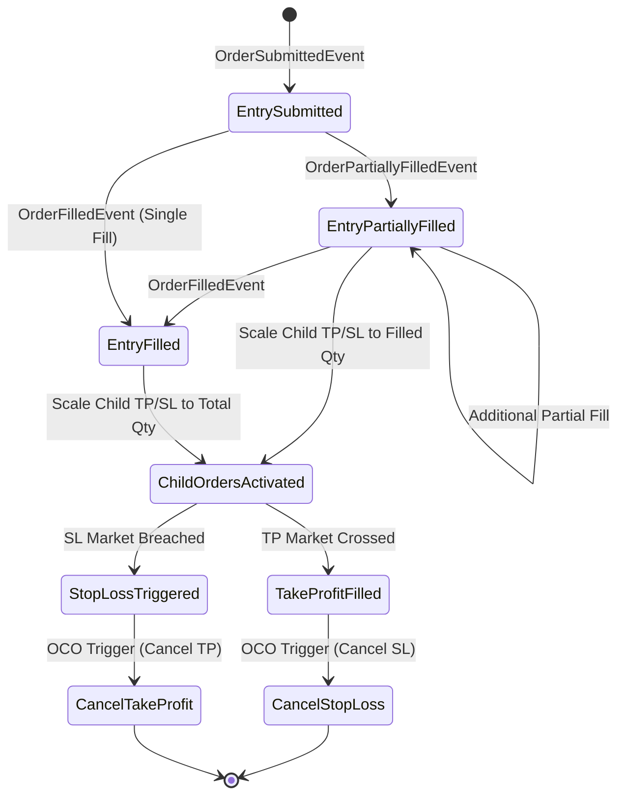
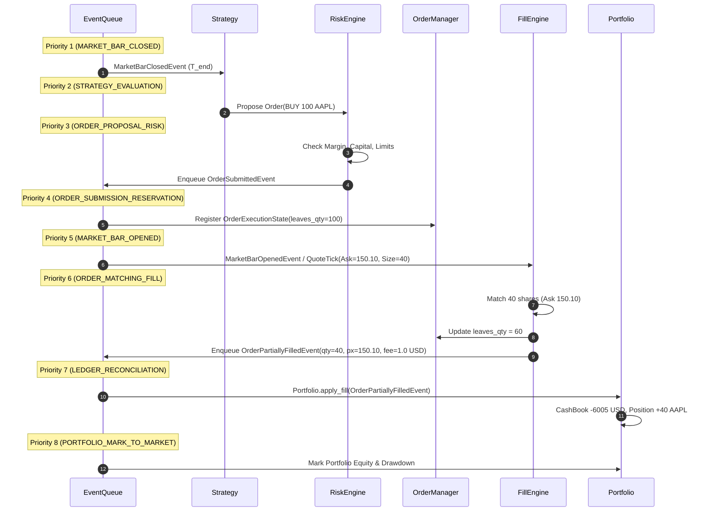

# Native Execution Engine Architecture Specification (Milestone 3B.4)

## Document Control
- **Milestone**: 3B.4 — Native Execution Engine Implementation Specification
- **Repository**: `Yokaham/hybrid-ai-trading-agent`
- **Parent Architecture**: `docs/BACKTEST_ENGINE_ARCHITECTURE.md`
- **Authoritative Accounting**: `hybrid_agent.execution.backtest.portfolio.Portfolio`
- **License**: Apache-2.0
- **Status**: APPROVED ARCHITECTURE SPECIFICATION (Pre-Implementation)

---

## 1. Architectural Mission & Core Principles

The objective of Milestone 3B.4 is to implement a deterministic, institutional-grade native execution engine composed of two distinct components:
1. **`OrderManager`**: Responsible for the order lifecycle, state transitions, remaining quantity tracking, OCO bracket relationships, child order scaling, and remainder cancellations.
2. **`FillEngine`**: A pure execution and matching transition function responsible for matching orders against market data (L1 quotes and OHLCV bars), simulating adverse slippage, respecting displayed liquidity and volume limits, and emitting deterministic execution events.

### Mandatory System Invariants
1. **Single Authoritative Accounting**: The existing `Portfolio` (CashBook, AccountingLedger, PositionTracker) remains the **sole source of truth** for cash balances, positions, margin, and realized/unrealized P&L. The `FillEngine` and `OrderManager` maintain **zero** independent cash balances or position tracking.
2. **Immutable Domain Contract**: The `Order` domain model remains an immutable specification of initial intent. Dynamic execution telemetry is tracked exclusively within an `OrderExecutionState` wrapper.
3. **Strict Temporal Causality**:
   $$T_{\text{execution}} \ge T_{\text{submission}} \ge T_{\text{signal}} \ge T_{\text{bar\_end}}$$
   A completed bar is available only at or after its end timestamp. Retrospective execution is strictly forbidden.
4. **Deterministic Reproducibility**: Given identical input events and seed, the engine must produce bit-for-bit identical execution sequences and trade identifiers.
5. **Supported Asset Classes**: Strictly restricted to **fully funded cash equities** and **linear CFDs**. Non-linear derivatives, inverse contracts, and multi-leg option spreads fail closed.

---

## 2. Resolution of Order Lifecycle & `PARTIALLY_FILLED` State

### Architectural Problem
The core `OrderStatus` enumeration (`src/hybrid_agent/core/constants.py`) currently defines:
```python
class OrderStatus(str, Enum):
    PENDING_RISK = "PENDING_RISK"
    APPROVED = "APPROVED"
    REJECTED = "REJECTED"
    SUBMITTED = "SUBMITTED"
    FILLED = "FILLED"
    CANCELLED = "CANCELLED"
```
It does not contain a `PARTIALLY_FILLED` status. An order in modern electronic markets frequently executes in multiple fills (e.g. 10 shares, 30 shares, 60 shares).

### Architectural Options Evaluated
- **Option 1: Mutate `OrderStatus` enum directly**: Add `PARTIALLY_FILLED` to `OrderStatus` and modify `ALLOWED_ORDER_TRANSITIONS` to permit `SUBMITTED -> PARTIALLY_FILLED -> PARTIALLY_FILLED -> FILLED`.
  - *Drawback*: While `Order` in `hybrid_agent.core.models` is an unfrozen Pydantic `BaseModel` with guarded `transition_to` lifecycle mutations, mutating macro `OrderStatus` on each fill conflates the client/risk contract intent with dynamic exchange micro-execution telemetry. It would also break existing state machines and risk validation checks across the codebase that rely on `OrderStatus`.
- **Option 2: Dedicated `OrderExecutionState` Wrapper (RECOMMENDED)**: Retain `OrderStatus` for macro lifecycle intent (`SUBMITTED -> [FILLED | CANCELLED]`), and manage execution progress inside a mutable, stateful wrapper:
  ```python
  @dataclass
  class OrderExecutionState:
      order: Order
      original_quantity: float
      filled_quantity: float = 0.0
      leaves_quantity: float = 0.0
      cumulative_fee: float = 0.0
      average_fill_price: float = 0.0
      is_partially_filled: bool = False
      is_completed: bool = False
      is_cancelled: bool = False
      fills: list[FillRecord] = field(default_factory=list)
  ```

### Justification
1. **Preserves Immutability of Domain Orders**: The client's original order parameters (`quantity`, `price`, `created_at`) are never lost or corrupted.
2. **Clear Separation of Concerns**: Macro lifecycle transitions (`APPROVED`, `SUBMITTED`, `CANCELLED`) belong to the client/risk domain; micro execution telemetry (`leaves_qty`, `cum_qty`, individual fill slices) belongs to the `OrderManager`.
3. **Multi-Fill State Invariance**: An order can receive multiple partial fills without violating enum transition idempotency.
4. **Backward Compatibility**: Existing risk policy, event queues, and portfolio tests continue interacting with immutable `Order` instances without breaking changes.

---

## 3. OrderManager Specification

> **Implementation Boundary Note (Milestone 3B.4.3)**:
> - **Implemented in Milestone 3B.4.1**: Foundational `OrderExecutionState`, `FillRecord`, `ExecutionStatus`, strict Decimal calculations, immutable fill records.
> - **Implemented in Milestone 3B.4.2**: Core `OrderManager` registry, dual-registry permanent vs. active order tracking, atomic fill-record routing, remainder cancellation, macro `OrderStatus` synchronization, and read-only `OrderExecutionSnapshot` / `OrderSnapshot` encapsulation isolating manager state from external mutation.
> - **Implemented in Milestone 3B.4.3**: Deterministic OCO bracket lifecycle (`BracketStatus`, `BracketOrderRole`, `BracketSnapshot`), pre-fill protection invariant (zero child orders on market before entry fill), dynamic child order scaling on partial entry fills via audited cancel-and-replace, OCO sibling cancellation and reduction on exit fills, exposure overrun and cancellation race breach tracking (`BracketExposureBreachError`), and complete portfolio accounting separation.
> - **Pending in Future Stages**: `FillEngine` price matching, quote consumption, and intrabar execution logic (deferred to Milestone 3B.4.4).

### 3.1 Responsibilities
- Registers risk-approved orders from `OrderSubmittedEvent` (Priority 4).
- Maintains the mapping of `order_id -> OrderExecutionState`.
- Manages parent-child contingent order relationships (OCO brackets, take-profit, stop-loss; planned).
- Handles partial fills by dynamically scaling child order quantities to match executed position inventory (planned).
- Cancels unfilled residual order quantity without modifying or reversing already-executed position inventory.
- Guarantees deterministic processing order.

### 3.2 OCO Bracket & Contingent Order Lifecycle


### 3.3 Dynamic Child Order Sizing on Partial Entry Fills
When an entry order receives a partial fill:
1. If child Stop-Loss (SL) and Take-Profit (TP) orders exist in a bracket:
   - Their initial active quantities are set to the **cumulative filled quantity** of the parent order:
     $$Q_{\text{child}} = Q_{\text{cumulative\_filled}}$$
   - If subsequent fills occur on the parent order, the `OrderManager` emits an `OrderModifiedEvent` or updates the registered child order quantity to match the updated position inventory:
     $$Q_{\text{child\_new}} = Q_{\text{child\_old}} + Q_{\text{new\_fill}}$$
2. If the user or strategy cancels the remaining entry quantity:
   - The unfilled remainder is cancelled via `OrderCancelledEvent`.
   - The executed quantity remains held in `Portfolio.positions`.
   - The child SL/TP orders remain active, perfectly protecting the executed quantity ($Q_{\text{executed}}$).
   - Executed positions are **never reversed or erased** when an unfilled entry remainder is cancelled.

### 3.4 Review Corrections & Invariant Hardening (Milestone 3B.4.3)
1. **Parent Entry Remainder Auto-Cancellation on Bracket Closure**:
   - When an exit fill completely closes a bracket ($\text{residual\_quantity} = 0$), any unexecuted leaves on the parent entry order are automatically cancelled with the simulation timestamp.
   - Historical parent fills are preserved; the bracket status remains `BracketStatus.CLOSED` (never marked `CANCELLED`).
   - Subsequent parent fills against a closed bracket are rejected with `InvalidBracketStateError`.
2. **Complete Child Leg Reconciliation**:
   - Exit fills (including late fills on previously cancelled legs) reconcile both active legs (same role and opposite role).
   - Guarantees that neither active leg has leaves exceeding $\text{residual\_quantity}$.
   - When residual quantity reaches zero, all active child orders are cancelled and active order references cleared.
3. **Explicit Permission for Late Fills**:
   - Cancelled orders reject late fills by default (`allow_late_fill=False`) with `InvalidOrderStateError`.
   - Recording late fills on cancelled orders requires explicit permission (`allow_late_fill=True`).
4. **Atomic Auto-Bracket Registration**:
   - Pre-flight validation against `InstrumentSpecification` ensures tick-size and price precision constraints before modifying state.
   - Failures during bracket/child creation trigger a clean transactional rollback leaving zero orphaned orders or partial brackets.

---

## 4. FillEngine Specification (Implemented in Milestone 3B.4.4)

### 4.1 Responsibilities
- Pure execution and matching transition function evaluating eligible order snapshots (`OrderExecutionSnapshot` or `OrderExecutionState`) against incoming market data (`Quote`, `Tick`, `Bar`) at Priority 6 (`ORDER_MATCHING_FILL`).
- Matches orders based on explicit order type rules (Market, Limit, Stop-Loss).
- Enforces displayed-size consumption on L1 quotes (no duplicate liquidity reuse within the same event; deterministic FIFO queue consumption across competing orders).
- Computes adverse slippage using non-linear volume share impact without double-charging the bid/ask spread (`RealQuoteSpreadModel` produces zero additive spread on quotes).
- Calculates commissions with mandatory explicit non-empty commission currency for all positive fees.
- Applies conservative tick-size adverse rounding (BUY ceil, SELL floor) and strictly enforces limit price protection ($P_{\text{exec}} \le P_{\text{limit}}$ for BUY; $P_{\text{exec}} \ge P_{\text{limit}}$ for SELL) after all costs.
- Generates canonical `FillCandidate` structures, cleanly adapting to `OrderFilledEvent` / `OrderPartiallyFilledEvent` for `Portfolio.apply_fill()` and `FillRecord` for `OrderManager.record_fill()`.

### 4.2 Matching Rules Matrix

| Order Type | Market Data Mode | Trigger / Crossing Condition | Execution Price | Liquidity Side |
| :--- | :--- | :--- | :--- | :--- |
| **Market BUY** | L1 Quote | Immediate upon arrival at $T \ge T_{\text{sub}}$ | $\text{Ask} + \text{Slippage}$ | TAKER |
| **Market SELL** | L1 Quote | Immediate upon arrival at $T \ge T_{\text{sub}}$ | $\text{Bid} - \text{Slippage}$ | TAKER |
| **Marketable Limit BUY** | L1 Quote | $\text{LimitPrice} \ge \text{Ask}$ | $\min(\text{LimitPrice}, \text{Ask} + \text{Slippage})$ | TAKER |
| **Resting Limit BUY** | L1 Quote | $\text{LimitPrice} \ge \text{Ask}$ (on later quote) | $\min(\text{LimitPrice}, \text{Ask} + \text{Slippage})$ | MAKER |
| **Resting Limit SELL** | L1 Quote | $\text{LimitPrice} \le \text{Bid}$ (on later quote) | $\max(\text{LimitPrice}, \text{Bid} - \text{Slippage})$ | MAKER |
| **Stop-Loss BUY** | L1 Quote | $\text{Ask} \ge \text{TriggerPrice}$ | $\text{Ask} + \text{Slippage}$ | TAKER |
| **Stop-Loss SELL** | L1 Quote | $\text{Bid} \le \text{TriggerPrice}$ | $\text{Bid} - \text{Slippage}$ | TAKER |
| **Bar-Only Market BUY** | OHLCV Bar | Next eligible bar open ($T_{\text{start}} > T_{\text{sub}}$) | $\text{Open} + \text{HalfSpread} + \text{Slippage}$ | TAKER |
| **Bar-Only Market SELL**| OHLCV Bar | Next eligible bar open ($T_{\text{start}} > T_{\text{sub}}$) | $\text{Open} - \text{HalfSpread} - \text{Slippage}$ | TAKER |
| **Bar-Only Limit BUY** | OHLCV Bar | $\text{SyntheticLowAsk} \le \text{LimitPrice}$ | $\min(\text{LimitPrice}, \text{OpenAsk}) + \text{Slippage}$ | MAKER |
| **Bar-Only Limit SELL**| OHLCV Bar | $\text{SyntheticHighBid} \ge \text{LimitPrice}$ | $\max(\text{LimitPrice}, \text{OpenBid}) - \text{Slippage}$ | MAKER |
| **Bar-Only Stop BUY** | OHLCV Bar | $\text{SyntheticHighAsk} \ge \text{TriggerPrice}$ | $\max(\text{TriggerPrice}, \text{OpenAsk}) + \text{Slippage}$ | TAKER |
| **Bar-Only Stop SELL** | OHLCV Bar | $\text{SyntheticLowBid} \le \text{TriggerPrice}$ | $\min(\text{TriggerPrice}, \text{OpenBid}) - \text{Slippage}$ | TAKER |

### 4.3 Review Corrections & Invariant Hardening (Milestone 3B.4.4)
1. **Market-Event Identity Independent of Ingestion Time**:
   - Canonical fingerprinting of market data events (`_create_event_fingerprint`) across immutable observation attributes: symbol, event type, timestamp, bid, ask, prices, and sizes.
   - Ingestion time (`retrieved_at`) and arbitrary provenance metadata are explicitly excluded from the fingerprint, guaranteeing that re-ingesting the identical market observation at different times yields identical fingerprints.
   - Provider sequence numbers/IDs (`sequence_id`, `sequence_number`, `sequence`, `seq`, `provider_event_id`, `event_id`, `message_id`, `msg_seq_num`) in `DataProvenance.metadata` are extracted and incorporated when present. If absent, canonical fallback `(source_name, source_type, is_synthetic)` is used.
   - Documented limitation: Indistinguishable identical observations lacking provider sequence IDs cannot be distinguished from retransmissions without inventing synthetic IDs.
   - Distinct events must carry distinct IDs; reusing an existing ID with a different observation raises `DuplicateMarketEventError`.
   - Presenting the same observation under multiple or renamed IDs raises `DuplicateMarketEventError` to prevent duplicate liquidity consumption.
   - Idempotent replay: Presenting the same observation under the same ID returns cached fills without re-consuming liquidity.
2. **Two-Phase Transactional Matching and Rollback Contract**:
   - `match_quote()` and `match_bar()` are atomic transactional operations.
   - Phase 1 (Staging): Candidate calculation, price derivation, local liquidity tracking (`staged_consumed_quote` / `staged_consumed_bar`), and incremental fee calculation against local state.
   - Phase 2 (Commit): State commit across liquidity and commission models occurs only after all candidates in the matching call are constructed and verified.
   - Rollback on Failure: If any error occurs in Phase 1 or Phase 2, `_restore_state()`, `liquidity_model.restore()`, and `commission_model.restore()` revert all state to the pre-call snapshot ($S_0$).
   - Models must implement the `snapshot() -> Any` and `restore(snapshot: Any) -> None` contract.
3. **Commission Fill-ID Consistency and Conflict Safety**:
   - `_committed_fills` tracks `(order_id, fill_price, fill_quantity, fee, currency)` across commission models, and incorporates effective `contract_size` in `PercentageCommissionModel`.
   - Replaying identical fill IDs with matching details (including contract size) is idempotent.
   - Reusing an existing `fill_id` with conflicting order, price, quantity, contract size, or fee details raises explicit `CommissionConflictError(ValueError)`.
   - Distinct fills with different IDs are never deduplicated.
4. **Finite Unbounded Liquidity Ceiling**:
   - Replaced all non-finite `Decimal("Infinity")` in `DefaultLiquidityModel` with finite `UNBOUNDED_LIQUIDITY_CEILING = Decimal(1_000_000_000)`.
   - Available and remaining liquidity are always strictly finite decimals.
5. **Preserve Explicit Commission Currency in Portfolio Integration**:
   - Introduces `PortfolioFillApplication` and `FillCandidate.to_portfolio_application()` / `to_portfolio_event_and_currency()`.
   - Packages fill events with exact, un-inferred `commission_currency` from canonical `FillRecord` for direct input to `Portfolio.apply_fill()`.
6. **Strict Non-Finite Numeric Validation & Strictly Positive Prices**:
   - Rejects non-finite values (`NaN`, `Infinity`, `-Infinity`) across all models and inputs.
   - Enforces strictly positive execution prices ($P_{\text{exec}} > 0$).
7. **Bar Execution Timestamp Availability Convention**:
   - Clarifies that `bar.end_time` for intrabar touches is an availability-time and confirmation convention, preventing forward-looking bias while avoiding false microsecond precision claims.

---

## 5. Important Execution Constraints & Rules

### Constraint 1: Never Charge the Spread Twice
- In L1 quote execution, the bid/ask spread is **already naturally paid** because buyers execute at Ask and sellers execute at Bid.
- In quote-driven execution, additional slippage is applied **only** when order size exceeds top-of-book displayed depth (market impact).
- Additional spread charges must never be added to an execution that already matched against Ask or Bid.

### Constraint 2: No Exchange Queue-Position Realism on L1 Data
- Top-of-book L1 quotes provide only $(P_{\text{bid}}, Q_{\text{bid}}, P_{\text{ask}}, Q_{\text{ask}})$. They do not contain individual order queue positions or market depth (L2/L3).
- The `FillEngine` must not fabricate synthetic queue positions. It uses deterministic FIFO order processing based on internal submission time sequence.
- All documentation must explicitly disclaim exchange queue simulation when running on L1 feeds.

### Constraint 3: Traded Volume Must Only Use `REAL_TRADED` Volume
- Volume participation limits must strictly verify that bar volume represents actual executed trades (`VolumeSource.REAL_TRADED`).
- Tick counts, volume approximations, or forex tick activity must **never** be treated as traded shares or contracts. If real volume is missing, volume participation caps are disabled and conservative sizing alerts are raised.

### Constraint 4: Data Availability & Temporal Boundaries
- A bar completed at $T_{\text{end}}$ is only available for strategy evaluation at $T_{\text{avail}} \ge T_{\text{end}} + \text{latency}$.
- An order submitted in response to that bar cannot execute against that same bar retrospectively.
- The earliest possible execution for that order is the start of the next eligible bar ($T_{\text{next\_start}}$) or a subsequent quote tick.

### Constraint 5: Conservative Resolution of Ambiguous Intra-Bar Touches
- When simulating with OHLCV bars, intra-bar price trajectory is unobservable.
- If a bar's extremes breach **both** the Stop-Loss and Take-Profit prices ($\text{Low} \le P_{\text{SL}}$ and $\text{High} \ge P_{\text{TP}}$):
  - The engine must adopt a **strictly conservative policy**: **Stop-Loss executes first**.
  - A trading simulation must never assume optimistic intra-bar fills that flatter backtest performance.

### Constraint 6: Adverse Slippage Bound by Limit Price
- Slippage must always be adverse to the order:
  $$\Delta P_{\text{buy}} \ge 0, \quad \Delta P_{\text{sell}} \le 0$$
- Slippage must **never** cause a limit order to execute at an inferior price to its limit:
  $$P_{\text{exec, buy limit}} \le P_{\text{limit}}, \quad P_{\text{exec, sell limit}} \ge P_{\text{limit}}$$
- If adverse slippage pushes the execution price beyond the limit price, the order remains unexecuted or partially filled up to the limit boundary.

### Constraint 7: Sole Authoritative Accounting
- `FillEngine` outputs `OrderFilledEvent` and `OrderPartiallyFilledEvent`.
- These events are dispatched at Priority 7 (`LEDGER_RECONCILIATION`) to `Portfolio.apply_fill()`.
- The `FillEngine` does not hold balances, track cash, calculate margin, or maintain positions.

### Constraint 8: Precision & UTC Event Ordering
- All prices, quantities, and cash transactions must use Python `Decimal` or lossless string representations.
- All timestamps must be timezone-aware `datetime` instances strictly in `UTC`.

### Constraint 9: Resolution of `PARTIALLY_FILLED`
- Solved via `OrderExecutionState` wrapper (Section 2).

### Constraint 10: Supported Asset Classes
- Fully funded cash equities (`ValuationModel.LINEAR`).
- Linear CFDs (`ValuationModel.LINEAR`).
- Any instrument requiring inverse pricing, non-linear delta/gamma, or physical commodity delivery is rejected at risk approval and matching.

---

## 6. Component Interfaces & Specifications

### 6.1 `OrderExecutionState` Data Model
```python
from dataclasses import dataclass, field
from datetime import datetime
from decimal import Decimal
from hybrid_agent.core.models import Order


@dataclass
class FillRecord:
    fill_id: str
    price: float
    quantity: float
    fee: float
    fee_currency: str
    slippage: float
    timestamp: datetime


@dataclass
class OrderExecutionState:
    order: Order
    original_quantity: float
    filled_quantity: float = 0.0
    leaves_quantity: float = 0.0
    average_fill_price: float = 0.0
    cumulative_fee: float = 0.0
    is_partially_filled: bool = False
    is_completed: bool = False
    is_cancelled: bool = False
    fills: list[FillRecord] = field(default_factory=list)

    def record_fill(
        self,
        price: float,
        quantity: float,
        fee: float,
        fee_currency: str,
        slippage: float,
        timestamp: datetime,
    ) -> None:
        """Applies fill atomically and updates weighted average entry price."""
        if quantity <= 0.0:
            raise ValueError(f"Fill quantity must be positive: {quantity}")
        if self.leaves_quantity < quantity - 1e-9:
            raise ValueError(
                f"Fill quantity {quantity} exceeds leaves quantity {self.leaves_quantity}"
            )

        new_filled = self.filled_quantity + quantity
        total_value = (self.average_fill_price * self.filled_quantity) + (price * quantity)
        self.average_fill_price = total_value / new_filled
        self.filled_quantity = new_filled
        self.leaves_quantity = max(0.0, self.original_quantity - self.filled_quantity)
        self.cumulative_fee += fee

        self.fills.append(
            FillRecord(
                fill_id=f"fill-{len(self.fills) + 1}",
                price=price,
                quantity=quantity,
                fee=fee,
                fee_currency=fee_currency,
                slippage=slippage,
                timestamp=timestamp,
            )
        )

        if self.leaves_quantity <= 1e-9:
            self.is_completed = True
            self.is_partially_filled = False
        else:
            self.is_partially_filled = True
```

### 6.2 `OrderManager` Interface
```python
class OrderManager:
    """Manages active order inventory, contingent relationships, and execution states."""

    def register_order(self, order: Order) -> OrderExecutionState:
        """Registers a risk-approved order into active management."""
        ...

    def get_execution_state(self, order_id: str) -> OrderExecutionState | None:
        """Retrieves dynamic execution state for a given order ID."""
        ...

    def register_bracket(self, parent_id: str, take_profit_id: str, stop_loss_id: str) -> None:
        """Registers parent entry and child OCO protective bracket."""
        ...

    def on_fill(self, fill_event: OrderFilledEvent | OrderPartiallyFilledEvent) -> list[Order]:
        """Updates execution state and dynamically scales child bracket quantities."""
        ...

    def cancel_order(self, order_id: str, reason: str, timestamp: datetime) -> OrderCancelledEvent:
        """Cancels unfilled remainder without affecting executed position inventory."""
        ...
```

### 6.3 `FillEngine` Interface
```python
class FillEngine:
    """Deterministic order matching engine evaluating market data against active orders."""

    def __init__(
        self,
        spread_model: SpreadModel | None = None,
        slippage_model: SlippageModel | None = None,
        commission_model: CommissionModel | None = None,
        liquidity_model: LiquidityModel | None = None,
        instrument_specs: dict[str, InstrumentSpecification] | None = None,
    ) -> None: ...

    def register_instrument(self, symbol: str, spec: InstrumentSpecification) -> None:
        """Registers instrument specification for lot sizing, tick sizing, and currencies."""
        ...

    def match_quote(
        self,
        quote: Quote | Tick,
        active_orders: Sequence[OrderExecutionSnapshot | OrderExecutionState],
        market_event_id: str | None = None,
    ) -> list[FillCandidate]:
        """Matches active orders against top-of-book quote and consumes displayed size."""
        ...

    def match_bar(
        self,
        bar: Bar,
        active_orders: Sequence[OrderExecutionSnapshot | OrderExecutionState],
        market_event_id: str | None = None,
    ) -> list[FillCandidate]:
        """Matches eligible orders against bar Open, range extremes, or synthetic quote."""
        ...

    def reset(self) -> None:
        """Resets all transient simulation state to start a clean backtest."""
        ...
```

### 6.4 Execution Models & Portfolio Integration Structures
```python
@dataclass(frozen=True)
class PortfolioFillApplication:
    """Explicit container coupling fill event and commission currency for Portfolio integration."""

    event: OrderFilledEvent | OrderPartiallyFilledEvent
    commission_currency: str | None


class CommissionModel(Protocol):
    """Protocol for execution commission calculation and stateful order tracking."""

    def calculate_commission(
        self,
        order: OrderSnapshot | Order,
        fill_price: Decimal,
        fill_quantity: Decimal,
        spec: InstrumentSpecification | None = None,
    ) -> CommissionResult: ...

    def commit_commission(
        self,
        order: OrderSnapshot | Order,
        fill_price: Decimal,
        fill_quantity: Decimal,
        spec: InstrumentSpecification | None = None,
        fill_id: str | None = None,
    ) -> CommissionResult: ...
```

---

## 7. Event-Flow Sequence



---

## 8. Test Verification Plan (Milestone 3B.4)

When Milestone 3B.4 implementation begins, the test suite must verify the following test cases:

1. **Market Orders**:
   - `test_market_buy_executes_at_ask_with_spread`: Verifies Buy matches Ask and Sell matches Bid.
   - `test_market_order_quote_consumption`: Verifies two market buy orders at the same timestamp consume displayed ask size sequentially.
2. **Limit Orders**:
   - `test_resting_limit_buy_holds_until_crossed`: Verifies limit order does not fill while market is above limit.
   - `test_marketable_limit_fills_immediately`: Verifies marketable limit fills at current Ask or better.
   - `test_slippage_never_exceeds_limit_price`: Verifies limit order rejects fills that exceed limit price.
3. **Stop Orders**:
   - `test_stop_market_trigger_and_market_fill`: Verifies stop-market order triggers on touch and fills at current quote.
   - `test_ambiguous_bar_stop_loss_takes_priority`: Verifies that when OHLC touches both TP and SL, SL fills first.
4. **OrderManager & Contingent Brackets**:
   - `test_partial_entry_scales_child_brackets`: Verifies child SL/TP are sized to executed partial fill quantity.
   - `test_cancel_remainder_preserves_executed_position`: Verifies cancelling remaining entry quantity preserves held inventory and active protective child orders.
   - `test_oco_trigger_cancels_opposite_child`: Verifies that when TP fills, SL is automatically cancelled.
5. **Real-Traded Volume Participation**:
   - `test_volume_participation_cap`: Verifies order execution does not exceed 10% of bar volume.
   - `test_volume_participation_requires_real_traded`: Verifies exception or warning when volume source is not `REAL_TRADED`.
6. **Accounting Consistency**:
   - `test_fill_events_integrate_seamlessly_with_portfolio`: Verifies all generated fill events pass directly into `Portfolio.apply_fill()` with zero cash or position discrepancies.
