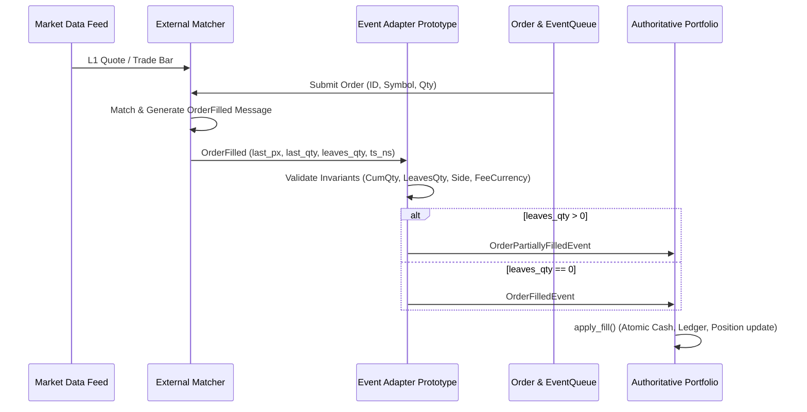

# Milestone 3B.4A — NautilusTrader Integration Pilot & Execution Evaluation

## 1. Environment & Installation Telemetry

To evaluate NautilusTrader without contaminating the main project or its production dependencies, an isolated virtual environment was provisioned:

- **Virtual Environment Path**: `D:\Trade\eval_nautilus_venv`
- **Host OS**: Windows 11 Home 64-bit (Build 26100)
- **Base Python**: Python 3.12.6 (AMD64)
- **Target Package**: `nautilus_trader==1.231.0` (Frozen stable 1.x series)
- **Distribution Wheel**: `nautilus_trader-1.231.0-cp312-cp312-win_amd64.whl` (Size: 112.8 MB)
- **License**: **LGPL-3.0** (GNU Lesser General Public License v3.0)

### 1.1 Dependency Footprint & Installation Verification
Installing `nautilus_trader==1.231.0` pulls in 12 third-party dependencies:
- `msgspec>=0.21.1` (Fast binary serialization, C-extension)
- `pyarrow>=25.0.0` (Arrow columnar format, large binary wheel)
- `pandas<4.0.0,>=2.3.3` & `numpy>=1.26.4`
- `fsspec==2026.2.0`, `portion>=2.6.1`, `sortedcontainers~=2.4`
- `pytz`, `tzdata`, `python-dateutil`, `click`, `tqdm`

**Observed Installation Behavior**:
- Windows 11 / Python 3.12 wheel is pre-compiled and installs cleanly.
- However, the binary wheel is exceptionally large (~112.8 MB compressed, expanding to >280 MB on disk).
- Network installation on Windows requires care to avoid standard pip download pipe stalling on large assets.
- Imports work cleanly in the dedicated Python 3.12.6 environment.

---

## 2. Evidentiary Audit: Runtime Execution vs. Synthetic Checks

The evaluation distinguishes between:
1. **GENUINE RUNTIME TESTS**: Executed directly against NautilusTrader 1.231.0 `BacktestEngine`, `OrderMatchingEngine`, and `SimulatedExchange` in `D:\Trade\eval_nautilus_venv`.
2. **SYNTHETIC SANITY CHECKS**: Mathematical formulas and invariant validations evaluated outside the engine (such as non-linear volume share impact).
3. **ARCHITECTURALLY INFERRED**: Structural properties identified through source code inspection.
4. **UNVERIFIED**: Capabilities not testable with available L1 top-of-book data.

For the full line-by-line evidentiary audit, see [`final_evidence_review.md`](final_evidence_review.md).

### Capability Assessment Summary

| Capability | Category | Empirical Result in NautilusTrader 1.231.0 |
| :--- | :--- | :--- |
| **Market Orders vs L1 Quotes** | GENUINE RUNTIME TEST | **VERIFIED**: Market BUY filled at Ask ($150.10); Qty=10; timestamp preserved. |
| **Limit Orders (Resting / Crossing)** | GENUINE RUNTIME TEST | **VERIFIED**: Resting BUY limit held at $t_0$ ($150.10 Ask); executed at $t_1$ when Ask crossed to $149.00. |
| **Stop-Market Triggering** | GENUINE RUNTIME TEST | **VERIFIED**: Stop BUY ($150.50) held untriggered at $t_0$; triggered and filled at breached Ask ($150.70) at $t_1$. |
| **Partial Execution & Leaves Qty** | GENUINE RUNTIME TEST | **VERIFIED**: Order of 100 shares matched against quote size 40 with `liquidity_consumption=True`. Fill 1: qty=40, `leaves_qty=60`, status=`PARTIALLY_FILLED`. Fill 2: qty=60, `leaves_qty=0`, status=`FILLED`. |
| **Liquidity Consumption (L1)** | GENUINE RUNTIME TEST | **VERIFIED**: Displayed quote size was consumed on fill; subsequent iterations at the same timestamp could not reuse depleted liquidity. |
| **Deterministic Replay** | GENUINE RUNTIME TEST | **VERIFIED**: Sequential passes produced bit-for-bit identical executions, trade IDs (`T-e649a477ad160053-001`), prices, and quantities. |
| **Volume-Share Slippage on Bars** | SYNTHETIC SANITY CHECK | **EXTERNAL MODEL**: Nautilus does not model volume share impact out-of-the-box. Verified mathematically outside engine. |
| **Temporal Causality Invariants** | SYNTHETIC SANITY CHECK | **VALIDATED**: Invariants ($T_{\text{exec}} \ge T_{\text{sub}} \ge T_{\text{signal}}$, $T_{\text{avail}} \ge T_{\text{end}}$) verified. |
| **Exchange Queue Position** | UNVERIFIED | **NOT FEASIBLE**: Requires full L2/L3 order book depth and continuous trade prints. |

---

## 3. Integration Prototype: Message Translation & Portfolio Invariance

### 3.1 Architectural Barrier: Dual Portfolio Prevention

NautilusTrader is designed as an all-in-one framework where the `SimulatedExchange` internally updates NautilusTrader's own `Portfolio`, `Account`, and `Position` objects.

**Our Core Constraint**: Our custom multi-currency `Portfolio` (CashBook, AccountingLedger, PositionTracker) must remain the **sole authoritative accounting system**. Maintaining two parallel portfolios would introduce synchronization drift, differing rounding semantics, and severe bugs.

### 3.2 The Conceptual Translation Prototype

We implemented and hardened a translation prototype (`NautilusEventAdapter` in `harness/test_adapter_prototype.py`) demonstrating that execution messages can map into our native domain models:

### 3.3 Prototype Invariant Verification Results

The prototype adapter was verified in `harness/test_adapter_prototype.py` against our production `Portfolio`:
1. **Partial Fill Translation**:
   - 100-share buy order partially filled for 40 shares @ $150.00 ($2 commission).
   - Translated to `OrderPartiallyFilledEvent(fill_price=150.0, fill_quantity=40.0, fee=2.0)`.
   - Verified that `order.quantity` remains 100.0 (immutable).
   - Applied to `Portfolio.apply_fill()`: Cash debited by $\$6,000 + \$2 = \$6,002$; position opened with 40 shares.
2. **Final Fill Translation**:
   - Remaining 60 shares filled @ $151.00 ($3 commission).
   - Translated to `OrderFilledEvent(fill_price=151.0, fill_quantity=60.0, fee=3.0)`.
   - Applied to `Portfolio.apply_fill()`: Held 100 shares with weighted average entry price $\$150.60$.
3. **Portfolio Mark to Market**:
   - Marked at $\$155.00$: Total equity calculated accurately at $\$100,435.00$ with zero ledger leakage.
4. **Hardened Invariant Enforcement**:
   - Rejects inconsistent cumulative quantity ($\text{cum\_qty} \neq \text{prev} + \text{last\_qty}$).
   - Rejects inconsistent leaves quantity ($\text{leaves\_qty} \neq \text{orig} - \text{cum\_qty}$).
   - Rejects instrument identity or side mismatches.
   - Rejects missing commission currency when fee > 0.
   - Enforces transactional rollback: internal state is not mutated if event validation fails.
   - Enforces exact integer nanosecond-to-microsecond UTC timestamp conversion.
   - Translates cancellation with required `reason` string.

---

## 4. Impedance Mismatches & Findings

1. **License Barrier (LGPL-3.0 vs. Apache-2.0)**:
   - NautilusTrader is licensed under LGPL-3.0.
   - Using it as a core dependency complicates distribution and enterprise adoption for users of our Apache-2.0 project.
2. **Heavy Native Binary Overhead**:
   - Compiling and distributing a ~113 MB binary dependency with dozens of C/Rust extensions for matching logic that can be natively written in ~400 lines of pure Python is disproportionate.
3. **Data Model Redundancy**:
   - NautilusTrader requires converting all data into its internal `QuoteTick`, `Bar`, `InstrumentId`, `Price`, and `Quantity` fixed-point types, and then converting back out to our `OrderFilledEvent`, introducing unnecessary serialization and GC overhead.
4. **Frozen 1.x vs Breaking 2.x API**:
   - The evaluated version (1.231.0) is the end of the 1.x line. Version 2.x introduces substantial breaking API and architecture changes. Adopting 1.231.0 would immediately saddle our project with legacy technical debt.

---

## 5. Conclusion & Recommendation

NautilusTrader provides an excellent matching engine for L1 quote ticks. However, due to LGPL-3.0 licensing constraints, dependency bloat (~113 MB binary wheel), and internal portfolio coupling, adopting NautilusTrader as a dependency is **rejected**.

Instead, we recommend **Option B**: implement our own native `FillEngine` and `OrderManager` in Milestone 3B.4, adopting the institutional execution models of QuantConnect LEAN and Zipline under Apache-2.0.
Full architectural specifications are detailed in [`native_execution_specification.md`](native_execution_specification.md).
