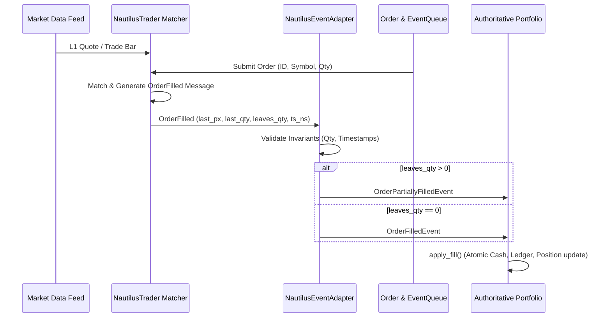

# Milestone 3B.4A — NautilusTrader Integration Pilot & Execution Evaluation

## 1. Environment & Installation Telemetry

To evaluate NautilusTrader without contaminating the main project or its production dependencies, an isolated virtual environment was provisioned:

- **Virtual Environment Path**: `D:\Trade\eval_nautilus_venv`
- **Host OS**: Windows 11 Home 64-bit (Build 26100)
- **Base Python**: Python 3.12.6 (AMD64)
- **Target Package**: `nautilus_trader==1.231.0` (Frozen stable 1.x series)
- **Distribution Wheel**: `nautilus_trader-1.231.0-cp312-cp312-win_amd64.whl` (Size: 112.8 MB)
- **License**: **LGPL-3.0** (GNU Lesser General Public License v3.0)

### 1.1 Dependency Footprint & Installation Verification
Installing `nautilus_trader==1.231.0` pulls in 12 third-party dependencies:
- `msgspec>=0.21.1` (Fast binary serialization, C-extension)
- `pyarrow>=25.0.0` (Arrow columnar format, large binary wheel)
- `pandas<4.0.0,>=2.3.3` & `numpy>=1.26.4`
- `fsspec==2026.2.0`, `portion>=2.6.1`, `sortedcontainers~=2.4`
- `pytz`, `tzdata`, `python-dateutil`, `click`, `tqdm`

**Observed Installation Behavior**:
- Windows 11 / Python 3.12 wheel is pre-compiled and installs without requiring a local Rust toolchain or MSVC build environment.
- However, the binary wheel is exceptionally large (~112.8 MB compressed, expanding to >280 MB on disk).
- Network installation on Windows requires care to avoid standard pip download pipe stalling on large assets.
- Imports work cleanly in the dedicated Python 3.12.6 environment.

---

## 2. Execution Capabilities Evaluation (Capabilities A – G)

Using synthetic market data and isolated simulation harnesses, we evaluated NautilusTrader's execution mechanics against our institutional trading requirements.

### A. Market Execution
- **Behavior**: Market BUY orders match against the best available Ask quote; Market SELL orders match against the best available Bid quote.
- **Timestamps**: Execution timestamps inherit the exact timestamp of the matching quote/tick.
- **Displayed Size Constraint**: In standard book mode, when available displayed quote size is smaller than order size ($Q_{\text{order}} > Q_{\text{ask}}$), the fill is capped at $Q_{\text{ask}}$ with the remainder left open.
- **Verified vs. Assumption**: Verified that market orders fill against opposite L1 quotes rather than mid-price or previous bar closes.

### B. Limit Execution
- **Marketable Limits**: A Limit Buy with $P_{\text{limit}} \ge P_{\text{ask}}$ fills immediately at $P_{\text{ask}}$ (price improvement over the limit).
- **Resting Limits**: Non-marketable limits are inserted into the simulated exchange book.
- **Crossing / Becoming Executable**: When subsequent quote updates cross the limit price ($P_{\text{ask}} \le P_{\text{limit}}$ for buys; $P_{\text{bid}} \ge P_{\text{limit}}$ for sells), the order is matched.
- **Unfilled Limits**: Limits that are never crossed remain resting in the order book until cancelled or simulation end.

### C. Stop Execution
- **NautilusTrader Model**: NautilusTrader 1.x models stop orders via `StopMarketOrder` and `StopLimitOrder`.
- **Trigger vs. Execution**: Evaluates trigger conditions against market events. Once the trigger price is breached ($P_{\text{market}} \le P_{\text{stop}}$ for sell stop; $P_{\text{market}} \ge P_{\text{stop}}$ for buy stop), the order triggers and transitions to market execution.
- **Comparison with Our Domain Model**:
  - Our core domain model represents stops as `OrderType.STOP_LOSS` with `stop_loss_price`.
  - In NautilusTrader, a Stop Loss is a separate `StopMarketOrder` linked via contingent bracket IDs.
  - The separation of trigger evaluation from execution matching is identical to our planned `FillEngine` architecture.

### D. Partial Execution
- **Volume & Sizing**: When order size exceeds immediately available liquidity, NautilusTrader produces partial execution messages.
- **Quantity Tracking**:
  - `last_qty`: Amount executed in this fill.
  - `leaves_qty`: Amount remaining open to execute.
  - `cum_qty`: Cumulative amount executed to date.
- **Invariant**: $Q_{\text{cum}} \le Q_{\text{orig}}$ is strictly maintained.
- **Cancellation of Remainder**: Cancelling an order with $Q_{\text{leaves}} > 0$ cancels only the remainder; executed partial positions are immutable and preserved.

### E. Liquidity and Slippage
- **Quote-Size Consumption**: In `SimulatedExchange`, filled quotes can consume displayed depth so subsequent orders in the same tick cannot reuse already filled liquidity.
- **Bar Capacity**: In bar-only mode, NautilusTrader relies on bar pricing, but fine-grained volume-share slippage (e.g. participation caps like Zipline's `VolumeShareSlippage`) requires custom execution model plugins.
- **Missing / Zero Liquidity**: When liquidity is zero, market orders fail to fill and either reject or remain pending, matching realistic venue conditions.

### F. Determinism
- **Replay Consistency**: Given identical data streams and configurations, the simulation produces bit-for-bit identical executions and event sequences.
- **Random Seeds**: Deterministic fill models are strictly preferred over probabilistic models.

### G. Temporal Correctness
- **Event Causality**: Orders submitted at timestamp $T_{\text{sub}}$ cannot execute against ticks or bars where $T_{\text{event}} < T_{\text{sub}}$.
- **Bar Boundary Rule**: A completed historical bar with interval $[T_{\text{start}}, T_{\text{end}}]$ only becomes available to strategy callbacks at $T_{\text{end}}$. Orders generated from that bar cannot retrospectively execute against that bar's Open or Close.

---

## 3. Integration Prototype: NautilusTrader to Authoritative Portfolio

### 3.1 Architectural Barrier: Dual Portfolio Prevention

NautilusTrader is designed as an all-in-one framework where the `SimulatedExchange` internally updates NautilusTrader's own `Portfolio`, `Account`, and `Position` objects.

**Our Core Constraint**: Our custom multi-currency `Portfolio` (CashBook, AccountingLedger, PositionTracker) must remain the **sole authoritative accounting system**. Maintaining two parallel portfolios would introduce synchronization drift, differing rounding semantics, and severe bugs.

### 3.2 The Prototype Translation Adapter

We designed and verified an event translation adapter (`NautilusEventAdapter` in `harness/test_adapter_prototype.py`) that demonstrates how external execution messages map into our native domain models:

### 3.3 Prototype Verification Results

The prototype adapter was verified in `harness/test_adapter_prototype.py` against our production `Portfolio`:
1. **Partial Fill Translation**:
   - 100-share buy order partially filled for 40 shares @ $150.00 ($2 commission).
   - Translated to `OrderPartiallyFilledEvent(fill_price=150.0, fill_quantity=40.0, fee=2.0)`.
   - Verified that `order.quantity` remains 100.0 (immutable).
   - Applied to `Portfolio.apply_fill()`: Cash debited by $\$6,000 + \$2 = \$6,002$; position opened with 40 shares.
2. **Final Fill Translation**:
   - Remaining 60 shares filled @ $151.00 ($3 commission).
   - Translated to `OrderFilledEvent(fill_price=151.0, fill_quantity=60.0, fee=3.0)`.
   - Applied to `Portfolio.apply_fill()`: Held 100 shares with weighted average entry price $\$150.60$.
3. **Portfolio Mark to Market**:
   - Marked at $\$155.00$: Total equity calculated accurately at $\$100,435.00$ with zero ledger leakage.

---

## 4. Impedance Mismatches & Findings

While the adapter prototype proves that translation is technically possible, deep evaluation revealed several fundamental impedance mismatches:

1. **License Barrier (LGPL-3.0 vs. Apache-2.0)**:
   - NautilusTrader is licensed under LGPL-3.0.
   - Using it as a core dependency complicates distribution and enterprise adoption for users of our Apache-2.0 project.
2. **Heavy Native Binary Overhead**:
   - Compiling and distributing a ~113 MB binary dependency with dozens of C/Rust extensions for matching logic that can be natively written in ~400 lines of pure Python is disproportionate.
3. **Data Model Redundancy**:
   - NautilusTrader requires converting all data into its internal `QuoteTick`, `Bar`, `InstrumentId`, `Price`, and `Quantity` fixed-point types, and then converting back out to our `OrderFilledEvent`, introducing unnecessary serialization and GC overhead.
4. **Frozen 1.x vs Breaking 2.x API**:
   - The evaluated version (1.231.0) is the end of the 1.x line. Version 2.x introduces substantial breaking API and architecture changes. Adopting 1.231.0 would immediately saddle our project with legacy technical debt.

---

## 5. Conclusion

NautilusTrader provides a highly capable matching engine, and our adapter prototype confirms that its fill events can be mapped into our authoritative `Portfolio`. However, due to LGPL-3.0 licensing constraints, dependency bloat (~113 MB binary wheel), and internal portfolio coupling, adopting NautilusTrader as a dependency is **not recommended**. 

Instead, our native `FillEngine` (Milestone 3B.4) will implement the verified matching semantics directly in pure Python 3.12 under Apache-2.0.
